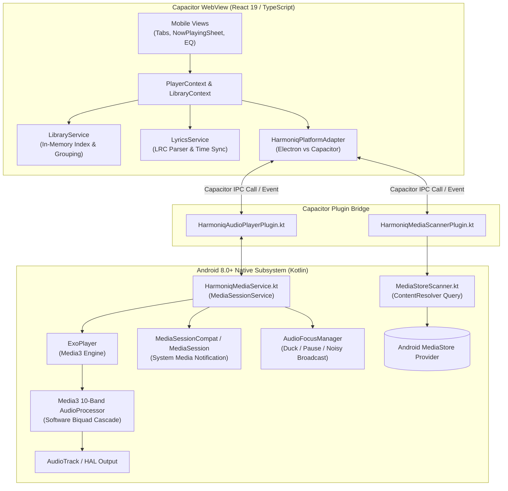

# HARMONIQ LITE — ANDROID ARCHITECTURE SPECIFICATION

**Document Version:** 1.0.0
**Status:** Architecture Proposal & Specification
**Target:** Harmoniq Lite (Android Local-First Audio Player)
**Base Repository:** [ByteCraft0/Harmoniq](https://github.com/ByteCraft0/Harmoniq)

---

## 1. System Architecture Overview

Harmoniq Lite uses a **hybrid decoupling architecture**:
- **Presentation Layer (Web/Capacitor):** React 19 + TypeScript + Tailwind CSS running within Android WebView, responsible for view rendering, user interaction, search filtering, and playlist management.
- **Native Platform & Audio Core (Android Native):** Kotlin-based Android native services built on `androidx.media3`, responsible for decoding, playback lifecycle, media session notifications, hardware audio focus, and low-level storage indexing.
- **Bridge Abstraction Layer:** A typed Capacitor plugin interface (`IHarmoniqNativeBridge`) that mirrors the capabilities previously provided by Electron's `harmoniqApi`, enabling seamless execution across environments.



---

## 2. Native Android Media3 Audio Engine

### 2.1 Why Media3 ExoPlayer is Required
In Windows desktop Harmoniq, audio playback is handled by HTML5 `<audio>` elements feeding Web Audio nodes (`src/services/audioEngine.ts:65-100`). In Android, web view audio processing cannot sustain background execution. Harmoniq Lite replaces this with `androidx.media3.exoplayer.ExoPlayer`.

### 2.2 `HarmoniqMediaService` Lifecycle Implementation
The native playback engine runs as a bound and started `MediaSessionService`:

```kotlin
// Android Native: HarmoniqMediaService.kt
package com.harmoniq.lite.audio

import android.content.Intent
import androidx.media3.common.AudioAttributes
import androidx.media3.common.C
import androidx.media3.common.MediaItem
import androidx.media3.common.Player
import androidx.media3.exoplayer.ExoPlayer
import androidx.media3.session.MediaSession
import androidx.media3.session.MediaSessionService

class HarmoniqMediaService : MediaSessionService() {
    private var mediaSession: MediaSession? = null
    lateinit var player: ExoPlayer
    private lateinit var dspAudioProcessor: HarmoniqDspAudioProcessor

    override fun onCreate() {
        super.onCreate()

        // 1. Initialize Custom DSP Pipeline (10-Band Biquad Cascade)
        dspAudioProcessor = HarmoniqDspAudioProcessor()

        // 2. Initialize ExoPlayer with AudioAttributes for Focus Handling
        val audioAttributes = AudioAttributes.Builder()
            .setUsage(C.USAGE_MEDIA)
            .setContentType(C.AUDIO_CONTENT_TYPE_MUSIC)
            .build()

        player = ExoPlayer.Builder(this)
            .setAudioAttributes(audioAttributes, /* handleAudioFocus = */ true)
            .setRenderersFactory(HarmoniqRenderersFactory(this, dspAudioProcessor))
            .build()

        // 3. Register Noisy Broadcast (Headphone Disconnect)
        registerNoisyReceiver()

        // 4. Attach MediaSession (Drives Android 13+ Notification Controls)
        mediaSession = MediaSession.Builder(this, player).build()
    }

    override fun onGetSession(controllerInfo: MediaSession.ControllerInfo): MediaSession? {
        return mediaSession
    }

    override fun onDestroy() {
        mediaSession?.run {
            player.release()
            release()
            mediaSession = null
        }
        unregisterNoisyReceiver()
        super.onDestroy()
    }
}
```

### 2.3 Audio Focus & Headphone Disconnection
1. **Audio Focus Handling:** `handleAudioFocus = true` instructs ExoPlayer to automatically duck music when navigation or assistant prompts speak, and pause when phone calls arrive. Upon call termination, playback resumes seamlessly.
2. **Audio Becoming Noisy Broadcast:**
   ```kotlin
   private val noisyReceiver = object : BroadcastReceiver() {
       override fun onReceive(context: Context?, intent: Intent?) {
           if (AudioManager.ACTION_AUDIO_BECOMING_NOISY == intent?.action) {
               player.pause()
           }
       }
   }
   ```

### 2.4 Lock-Screen & Notification Controls
By utilizing `MediaSessionService` with Android Media3, Harmoniq Lite automatically receives Android 13+ (API 33+) System Media Notification support:
- Live seekbar and squiggly waveform progress.
- Album artwork dynamically loaded into notification background.
- Standard media actions (Previous, Play/Pause, Next) with custom action slots (Favorite toggle, Repeat mode).
- Integration with Android Auto, Wear OS, and Bluetooth AVRCP (car dashboards, smartwatches, and headphones).

---

## 3. Media Scanning & Scoped Storage Architecture

### 3.1 MediaStore Query Architecture
On Android 10+ (API 29+), direct recursive traversal of `/storage/emulated/0/` is restricted and slow. Harmoniq Lite queries the Android `MediaStore` ContentProvider via `ContentResolver`:

```kotlin
// Android Native: MediaStoreScanner.kt
package com.harmoniq.lite.scanner

import android.content.ContentUris
import android.content.Context
import android.net.Uri
import android.provider.MediaStore
import com.harmoniq.lite.models.NativeTrackMetadata

class MediaStoreScanner(private val context: Context) {

    fun scanAllAudio(): List<NativeTrackMetadata> {
        val trackList = mutableListOf<NativeTrackMetadata>()
        val projection = arrayOf(
            MediaStore.Audio.Media._ID,
            MediaStore.Audio.Media.TITLE,
            MediaStore.Audio.Media.ARTIST,
            MediaStore.Audio.Media.ALBUM,
            MediaStore.Audio.Media.ALBUM_ID,
            MediaStore.Audio.Media.DURATION,
            MediaStore.Audio.Media.TRACK,
            MediaStore.Audio.Media.YEAR,
            MediaStore.Audio.Media.MIME_TYPE,
            MediaStore.Audio.Media.SIZE,
            MediaStore.Audio.Media.DATE_MODIFIED
        )

        val selection = "${MediaStore.Audio.Media.IS_MUSIC} != 0"
        val sortOrder = "${MediaStore.Audio.Media.TITLE} ASC"

        val uri = MediaStore.Audio.Media.EXTERNAL_CONTENT_URI

        context.contentResolver.query(uri, projection, selection, null, sortOrder)?.use { cursor ->
            val idCol = cursor.getColumnIndexOrThrow(MediaStore.Audio.Media._ID)
            val titleCol = cursor.getColumnIndexOrThrow(MediaStore.Audio.Media.TITLE)
            val artistCol = cursor.getColumnIndexOrThrow(MediaStore.Audio.Media.ARTIST)
            val albumCol = cursor.getColumnIndexOrThrow(MediaStore.Audio.Media.ALBUM)
            val albumIdCol = cursor.getColumnIndexOrThrow(MediaStore.Audio.Media.ALBUM_ID)
            val durCol = cursor.getColumnIndexOrThrow(MediaStore.Audio.Media.DURATION)
            val trackCol = cursor.getColumnIndexOrThrow(MediaStore.Audio.Media.TRACK)
            val yearCol = cursor.getColumnIndexOrThrow(MediaStore.Audio.Media.YEAR)
            val mimeCol = cursor.getColumnIndexOrThrow(MediaStore.Audio.Media.MIME_TYPE)
            val sizeCol = cursor.getColumnIndexOrThrow(MediaStore.Audio.Media.SIZE)
            val modCol = cursor.getColumnIndexOrThrow(MediaStore.Audio.Media.DATE_MODIFIED)

            while (cursor.moveToNext()) {
                val id = cursor.getLong(idCol)
                val albumId = cursor.getLong(albumIdCol)
                val contentUri = ContentUris.withAppendedId(MediaStore.Audio.Media.EXTERNAL_CONTENT_URI, id)
                val artworkUri = ContentUris.withAppendedId(
                    Uri.parse("content://media/external/audio/albumart"), albumId
                )

                trackList.add(
                    NativeTrackMetadata(
                        id = "ms_$id",
                        filePath = contentUri.toString(),
                        fileName = cursor.getString(titleCol) ?: "Unknown",
                        fileSize = cursor.getLong(sizeCol),
                        dateModified = cursor.getLong(modCol) * 1000L,
                        title = cursor.getString(titleCol) ?: "Unknown Track",
                        artist = cursor.getString(artistCol) ?: "Unknown Artist",
                        album = cursor.getString(albumCol) ?: "Unknown Album",
                        duration = cursor.getLong(durCol) / 1000.0,
                        trackNumber = cursor.getInt(trackCol),
                        year = cursor.getInt(yearCol),
                        mimeType = cursor.getString(mimeCol) ?: "audio/mpeg",
                        artworkUri = artworkUri.toString()
                    )
                )
            }
        }
        return trackList
    }
}
```

### 3.2 Artwork Optimization (Avoiding Memory Leaks)
In desktop Harmoniq (`electron/main.ts:3616`), artwork is extracted as Base64 strings. Storing 5,000 base64 strings in mobile RAM would trigger an Out-Of-Memory (OOM) error.

**Harmoniq Lite Protocol:**
1. Native scanner emits `artworkUri` pointing to `content://media/external/audio/albumart/<albumId>`.
2. A lightweight native image loading plugin or local Capacitor custom scheme (`harmoniq-art://`) resolves the URI on demand.
3. React renders ``, delegating memory eviction to Chromium's image cache.

---

## 4. Equalizer and DSP Implementation Strategy

Harmoniq 2.0 provides a 10-band ISO graphic equalizer and a 12-band parametric equalizer using Web Audio `BiquadFilterNode` (`src/services/audioEngine.ts:71-72`).

On Android, there are two potential implementation paths:

### 4.1 Path A: Native Android `audiofx.Equalizer`
- **Pros:** Built into Android framework; hardware-accelerated.
- **Cons:** Fixed band counts! Most Android devices only support 5 bands. Parametric filters are completely unsupported. Frequencies and Q factors are locked by device OEM DAC firmware.

### 4.2 Path B: Media3 Custom `AudioProcessor` (Recommended)
- **Architecture:** Implement `androidx.media3.common.audio.AudioProcessor` in Kotlin or C++ (via JNI).
- **Processing:** Direct PCM filter calculation (biquad Direct Form II Transposed) operating on 16-bit or 32-bit float audio frames directly before passing to `AudioTrack`.
- **Capability:** Enables exact 10-band ISO frequencies (31Hz, 63Hz, 125Hz, 250Hz, 500Hz, 1kHz, 2kHz, 4kHz, 8kHz, 16kHz) and full parametric peaking/shelving EQ matching desktop Harmoniq bit-for-bit across all Android devices.
- **CPU Overhead:** $\approx 0.8\%\text{--}1.5\%$ on a standard modern ARM Cortex-A55 core. Negligible battery impact.

```
ExoPlayer Audio Pipeline:
[Decoder: MediaCodec]
       ↓ (Raw PCM Stream)
[HarmoniqDspAudioProcessor]
   ├── Preamp Gain Stage
   ├── 10-Band Biquad Filter Cascade
   └── Soft Peak Limiter
       ↓ (Processed PCM)
[AudioTrack (Android HAL / AudioFlinger)]
```

---

## 5. Synchronized Lyrics Architecture

Harmoniq's `src/services/lyricsService.ts` contains:
1. `parseLrc(content, source)`: Parses standard LRC timestamps (`[mm:ss.xx]`) into sorted line arrays.
2. `loadLyricsForTrack(track)`: Fallback cascade:
   - Check local `.lrc` companion file.
   - Check embedded ID3/Vorbis lyrics.
   - Fallback to LRCLIB online REST API (`https://lrclib.net/api/get`).

### Portability in Harmoniq Lite:
- `parseLrc` and LRCLIB HTTP fetch are **100% reusable** in WebView without modification.
- Local `.lrc` companion file detection: The native bridge searches for a matching `.lrc` file in the same directory using Android Scoped Storage / DocumentFile or MediaStore search and passes the raw text content across the bridge.

---

## 6. Capacitor Native Bridge Specification

The bridge is exposed to React through a unified TypeScript interface matching Harmoniq's expectations:

### 6.1 TypeScript Bridge Interface
```typescript
// src/services/bridge/IHarmoniqNativeBridge.ts
import { TrackMetadata } from '../../types/audio';
import { LyricsData } from '../../types/lyrics';
import { DSPSettings } from '../../types/dsp';

export interface IHarmoniqNativeBridge {
  // Playback Control
  play(track: TrackMetadata, queue: TrackMetadata[]): Promise<void>;
  pause(): Promise<void>;
  resume(): Promise<void>;
  seekTo(seconds: number): Promise<void>;
  setVolume(volume: number): Promise<void>;
  setPlaybackRate(rate: number): Promise<void>;

  // DSP & EQ
  setEqBands(gains: number[]): Promise<void>; // 10 bands (-12dB to +12dB)
  setPreamp(gainDb: number): Promise<void>;
  setDspEnabled(enabled: boolean): Promise<void>;

  // MediaStore Scanning
  scanMediaStore(): Promise<{ tracks: TrackMetadata[]; totalScanned: number }>;
  readCompanionLrc(filePath: string): Promise<string | null>;

  // Event Listeners
  onPlaybackStateChange(callback: (state: {
    isPlaying: boolean;
    currentTime: number;
    duration: number;
    trackId: string | null;
  }) => void): () => void;

  onTrackEnded(callback: () => void): () => void;
  onRemoteMediaCommand(callback: (command: 'play' | 'pause' | 'next' | 'prev') => void): () => void;
}
```

---

## 7. Storage & Offline-First Persistence

Desktop Harmoniq relies on Electron's `storage:save` and `storage:load` (`electron/main.ts:1493-1521`), writing JSON blobs to `userData`.

In Harmoniq Lite:
1. **Preferences & Small State:** Player settings (volume, repeat mode, shuffle, active EQ preset) are persisted via `@capacitor/preferences` (backed by Android `SharedPreferences`).
2. **Library Cache & Playlists:** Persisted using native SQLite (via `@capacitor-community/sqlite` or Android Room). Storing indexed tracks, playlists, and listening history in SQLite prevents the 5MB–10MB storage quota limits and unpredictable eviction of browser `localStorage`.
3. **Zero Network Requirement:** Harmoniq Lite functions 100% offline. Media scanning, decoding, playback, and equalizer operations execute entirely on-device.

---

## 8. Mobile UI/UX Architectural Adaptation

Desktop Harmoniq uses a wide, fixed multi-pane layout (`src/components/layout/`):
- `TitleBar.tsx`: Draggable window title bar with minimize/maximize/close.
- `Sidebar.tsx`: Fixed 240px desktop sidebar.
- `BottomPlayer.tsx`: Persistent desktop playback toolbar with hover tooltips and dense buttons.
- `QueueDrawer.tsx`: Right slide-out desktop panel.

### Harmoniq Lite Mobile Layout Architecture:
1. **Remove TitleBar & Sidebar:** Replace with:
   - **Top AppBar:** Contextual header with search trigger and screen title.
   - **Bottom Navigation Bar:** 4 core destinations: **Home**, **Songs**, **Albums**, **Playlists** (with Settings accessible from top bar).
2. **MiniPlayer Dock:** Floats directly above the Bottom Navigation Bar ($56\text{dp}$ height), displaying current artwork, title, artist, and Play/Pause button.
3. **Expandable Now Playing Sheet:** Tapping the MiniPlayer expands a full-screen bottom sheet displaying high-resolution artwork, neon waveform scrubber, 10-band EQ shortcut, synchronized lyrics view, and queue.
4. **Touch-Target Compliance:** All clickable icons and interactive items conform to Material Design standards ($\ge 48\times 48\text{dp}$).
5. **Android System Bar Padding:** Uses CSS `env(safe-area-inset-top)` and `env(safe-area-inset-bottom)` to accommodate Android status bars, display cutouts, and gesture navigation bars.
