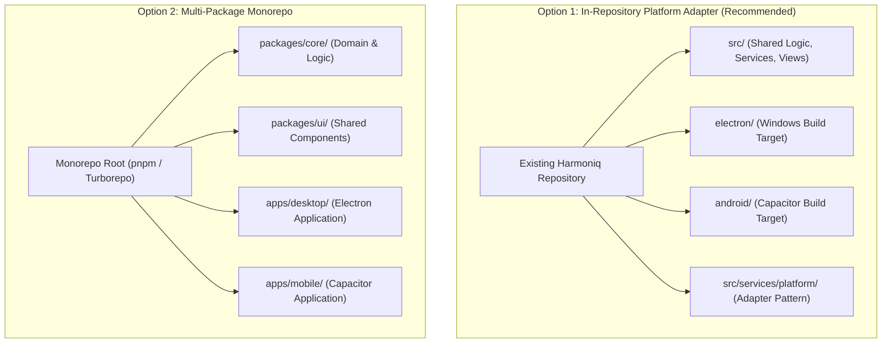

# HARMONIQ LITE — ANDROID COMPONENT REUSE MATRIX & CODE-SHARING STRATEGY

**Document Version:** 1.0.0
**Audit Date:** November 2026
**Auditor Roles:** Senior Android Architect, React/TypeScript Engineer, Electron Specialist, Mobile Audio Systems Engineer
**Target Repository:** [ByteCraft0/Harmoniq](https://github.com/ByteCraft0/Harmoniq)

---

## 1. Component Portability Classification

Every module across the Harmoniq codebase is categorized into one of four tiers:
1. **Tier 1 — Reusable As-Is (100% Shared):** Pure TypeScript logic, data structures, and algorithms with zero platform dependencies.
2. **Tier 2 — Reusable with Adaptation (Platform Inversion):** Components requiring storage driver substitution, path resolution adjustments, or responsive mobile CSS styling.
3. **Tier 3 — Must Replace (Platform Native Replacement):** Desktop/Electron-specific or Chromium Web Audio-bound implementations requiring dedicated native Android implementations.
4. **Tier 4 — Postponed / Excluded from MVP:** Non-essential or desktop-exclusive features deferred to maintain a lean, high-performance mobile MVP.

---

## 2. Complete Module-by-Module Reuse Matrix

### 2.1 Types & Domain Models (`src/types/`)

| File / Component Path | Primary Interfaces & Enums | Reuse Tier | Adaptation & Notes |
| :--- | :--- | :--- | :--- |
| `src/types/audio.ts` | `TrackMetadata`, `AudioCodec`, `ReplayGainData`, `QualityTier` | **Tier 1 (As-Is)** | 100% reusable. `artworkDataUrl` will carry `content://` URI instead of Base64 on Android. |
| `src/types/library.ts` | `Album`, `Artist`, `Playlist`, `FolderNode`, `LibraryStats` | **Tier 1 (As-Is)** | 100% reusable across desktop and mobile. |
| `src/types/dsp.ts` | `DSPSettings`, `EQPreset`, `ParametricFilterConfig`, `LimiterMetrics` | **Tier 1 (As-Is)** | 100% reusable for equalizer settings state. |
| `src/types/lyrics.ts` | `LyricLine`, `LyricsData` | **Tier 1 (As-Is)** | 100% reusable. |
| `src/types/history.ts` | `HistoryEntry`, `HistoryQueryOptions` | **Tier 1 (As-Is)** | 100% reusable. |
| `src/types/bookmark.ts` | `MusicBookmark` | **Tier 1 (As-Is)** | 100% reusable. |
| `src/types/appearance.ts` | `AppearanceSettings`, `ThemePresetId`, `THEME_PALETTES` | **Tier 1 (As-Is)** | Reusable for mobile dark/luxury theming. |
| `src/types/shortcuts.ts` | `ShortcutConfig`, `ShortcutAction` | **Tier 4 (Exclude)** | Desktop global hotkey bindings; not applicable to mobile touch UI. |
| `src/types/electron.ts` | `HarmoniqApi`, `WindowsAudioDeviceDiagnostic` | **Tier 3 (Replace)** | Replace with `IHarmoniqNativeBridge` definition. |

---

### 2.2 Core Services Layer (`src/services/`)

| File / Module Path | Key Functions & Responsibilities | Reuse Tier | Migration Strategy & Technical Notes |
| :--- | :--- | :--- | :--- |
| `src/services/libraryService.ts` | `addTracks()`, `getAlbums()`, `getArtists()`, `getGenres()`, `searchTracks()`, `createPlaylist()`, `serialize()`, `deserialize()` | **Tier 2 (Adapt)** | **Logic is 100% reusable.** In-memory indexing, grouped aggregations, and $<15\text{ms}$ search are preserved. Adapt persistence: redirect from `window.harmoniqApi.savePersistentData` to SQLite / Room. |
| `src/services/lyricsService.ts` | `parseLrc()`, `cleanTrackTitle()`, `findActiveLineIndex()`, `loadLyricsForTrack()` | **Tier 2 (Adapt)** | **Parser & LRCLIB fetch 100% reusable.** Adapt companion file search: call native bridge `readCompanionLrc()` instead of `harmoniqApi.readLrcFile()`. |
| `src/services/favoritesService.ts` | `toggleFavorite()`, `isFavorite()`, `syncWithLocalLibrary()`, `getFavorites()` | **Tier 2 (Adapt)** | **Logic is 100% reusable.** Map-based memory index with composite keying (`title:::artist`). Adapt storage backend to SQLite / Preferences. |
| `src/services/historyService.ts` | `recordPlay()`, `getHistory()`, `clearHistory()` | **Tier 2 (Adapt)** | **Logic is 100% reusable.** Adapt storage backend. |
| `src/services/colorExtractionService.ts` | `extractPalette()`, `getVibrantColor()` | **Tier 1 (As-Is)** | Uses `colorthief`. Works directly inside mobile WebView for dynamic ambient coloring. |
| `src/services/bookmarkService.ts` | `addBookmark()`, `getBookmarksForTrack()` | **Tier 1 (As-Is)** | 100% pure TypeScript. Reusable as-is. |
| `src/services/audioEngine.ts` | Dual-deck Web Audio API, `BiquadFilterNode` cascade, `harmoniq-media://` protocol | **Tier 3 (Replace)** | **Must Replace.** Web Audio in WebView cannot sustain background playback on Android. Replaced by native Media3 `ExoPlayer` in `HarmoniqMediaService.kt`. |
| `src/services/audio/stereoWidthProcessor.ts` | Web Audio ChannelSplitter / ChannelMerger M/S matrix | **Tier 3 (Replace)** | Must run in native audio processor or defer to post-MVP. |
| `src/services/shortcutService.ts` | Windows keyboard accelerators (`Ctrl+Shift+Space`) | **Tier 4 (Exclude)** | Desktop exclusive. |
| `src/services/portableService.ts` | USB flash drive portable data detection | **Tier 4 (Exclude)** | Desktop exclusive. |
| `src/services/windowLifecycleService.ts` | Electron window minimize/maximize throttle | **Tier 4 (Exclude)** | Desktop exclusive. Android handles lifecycle via Activity events. |
| `src/services/universalMusicService.ts` | Jamendo, Audius, Internet Archive streaming | **Tier 4 (Postpone)** | Postpone to Phase 2 (post-MVP) to ensure local-first stability. |
| `src/services/assistantService.ts` | Gemini, OpenAI, Groq cloud LLM chat router | **Tier 4 (Postpone)** | Postpone to Phase 3. Not needed for offline core player. |

---

### 2.3 Context Providers (`src/context/`)

| Context Provider Path | Key State & Operations | Reuse Tier | Adaptation & Notes |
| :--- | :--- | :--- | :--- |
| `src/context/PlayerContext.tsx` | `currentTrack`, `isPlaying`, `currentTime`, `duration`, `volume`, `queue`, `playTrack()`, `seekTo()`, `togglePlayPause()`, `nextTrack()` | **Tier 2 (Adapt)** | **Architecture preserved.** Replace calls to `audioEngine` with calls to `IHarmoniqNativeBridge`. Sync state via native player event listeners (`onPlaybackStateChange`). |
| `src/context/LibraryContext.tsx` | `tracks`, `albums`, `artists`, `playlists`, `searchQuery`, `refreshLibraryState()` | **Tier 2 (Adapt)** | **Architecture preserved.** Replace `window.harmoniqApi.scanFolder()` with `nativeBridge.scanMediaStore()`. Retain reactive state flow. |
| `src/context/DSPContext.tsx` | `settings`, `presets`, `setBandGain()`, `applyPreset()` | **Tier 2 (Adapt)** | **UI state preserved.** Route band gain mutations to native Media3 `AudioProcessor` via bridge instead of Web Audio nodes. |
| `src/context/ToastContext.tsx` | Toast notification queues and timers | **Tier 1 (As-Is)** | 100% reusable. |
| `src/context/NavigationContext.tsx` | View stack navigation | **Tier 2 (Adapt)** | Adapt to support mobile tab bar routing and Android hardware back button. |

---

### 2.4 User Interface Components (`src/components/`)

| Component / Subdirectory | Purpose | Reuse Tier | Mobile Strategy |
| :--- | :--- | :--- | :--- |
| `src/components/layout/TitleBar.tsx` | Draggable window title bar, window controls | **Tier 4 (Exclude)** | Exclude. Android manages title via native status bar / TopAppBar. |
| `src/components/layout/Sidebar.tsx` | 240px desktop side navigation bar | **Tier 3 (Replace)** | Replace with mobile **Bottom Navigation Bar** ($56\text{dp}$ height, 4 core tabs). |
| `src/components/layout/BottomPlayer.tsx` | Wide desktop player bar | **Tier 3 (Replace)** | Replace with **Docked MiniPlayer** + **Expandable Now Playing Bottom Sheet**. |
| `src/components/layout/QueueDrawer.tsx` | Right slide-out desktop drawer | **Tier 2 (Adapt)** | Adapt into a full-height swipeable bottom modal sheet for queue management. |
| `src/components/views/SongsView.tsx` | Songs table with sortable columns | **Tier 2 (Adapt)** | Adapt 8-column desktop table into a single-column mobile list view with large touch targets ($\ge 48\text{dp}$). |
| `src/components/views/AlbumsView.tsx` | Grid of album artwork cards | **Tier 2 (Adapt)** | Adapt 6-column desktop grid into responsive 2-column or 3-column mobile grid. |
| `src/components/views/PlaylistsView.tsx` | Playlist cards and track lists | **Tier 1 (As-Is)** | Highly reusable with minor mobile container padding adjustments. |
| `src/components/views/LyricsView.tsx` | Auto-scrolling synchronized karaoke lyrics | **Tier 1 (As-Is)** | **Directly reusable.** The smooth scroll algorithm and line highlighting work identically on mobile. |
| `src/components/dsp/EqualizerStudio.tsx` | Graphic 10-band sliders and preset picker | **Tier 2 (Adapt)** | Adapt slider widths and touch-drag event listeners for finger manipulation. |
| `src/components/audio/WaveformVolumeControl.tsx` | Neon sinusoidal SVG volume control | **Tier 2 (Adapt)** | Adapt for mobile touch scrub or allow device hardware volume buttons to manage volume. |
| `src/components/assistant/*` | Pulse Orb, voice transcription, AI chat | **Tier 4 (Postpone)** | Exclude from MVP. |
| `src/components/online/*` | Jamendo, Audius, Internet Archive views | **Tier 4 (Postpone)** | Exclude from MVP. |
| `src/components/views/ABXComparisonView.tsx` | Double-blind audio codec comparison | **Tier 4 (Exclude)** | Desktop audiophile tool; exclude from mobile Lite player. |
| `src/components/views/VinylCollectionView.tsx` | 3D vinyl turntable visualizer | **Tier 4 (Postpone)** | High GPU/battery overhead on mobile devices. |

---

## 3. Shared Code Strategy Comparison

We compare two architectural repository strategies for sharing code between Windows and Android:



### 3.1 Comprehensive Strategy Comparison

| Evaluation Criteria | Option 1: Current Repo + Platform Adapter | Option 2: Multi-Package Monorepo |
| :--- | :--- | :--- |
| **Safety & Desktop Stability** | **EXCELLENT (Zero Risk):** Desktop files, scripts (`npm run build`), and structure remain 100% untouched. | **HIGH RISK:** Requires moving hundreds of files, altering imports, and rewriting Vite/Electron configs. High regression risk. |
| **Folder Restructuring** | **None.** Maintains strict compliance with Phase 0 constraints. | **Extensive.** Splits code into `packages/*` and `apps/*`. |
| **Build & Tooling Complexity** | **Low.** Single `package.json`, standard Vite builds for both Electron and Capacitor. | **High.** Requires workspace manager (pnpm/Turborepo), cross-package symlinking, and dual tsconfig setups. |
| **Code Duplication** | **Zero.** React components, services, and models are shared directly from `src/`. | **Zero.** Code is shared via internal npm packages. |
| **Developer Ergonomics** | **High.** Developers run `npm run dev` or `npm run electron` exactly as before. Mobile is built via `npx cap sync`. | **Medium.** Complex build orchestration across workspace boundaries. |
| **CI / CD Pipeline Impact** | **Minimal.** Existing Windows NSIS/portable builder is unaffected. Android GitHub Action added as a separate job. | **Major.** Complete rewrite of build and release pipelines required. |

### 3.2 Architectural Recommendation: The Platform Adapter Pattern (Option 1)
**Recommendation:** Proceed with **Option 1 (Unified Repository with Platform Driver Adapter)**.

#### How It Operates:
1. Define a platform interface `IPlatformDriver`:
   ```typescript
   export interface IPlatformDriver {
     audio: IAudioDriver;
     scanner: IMediaScannerDriver;
     storage: IStorageDriver;
     platform: 'electron' | 'android' | 'web';
   }
   ```
2. In Electron (`window.harmoniqApi !== undefined`), the driver binds to `window.harmoniqApi` and `WebAudioEngine`.
3. In Android (`window.Capacitor?.isNativePlatform() === true`), the driver binds to `HarmoniqAudioPlayerPlugin` and native MediaStore scanner.
4. **Result:** The desktop application remains 100% functional and untouched. The Android build target seamlessly mounts the same React tree with zero code duplication.
