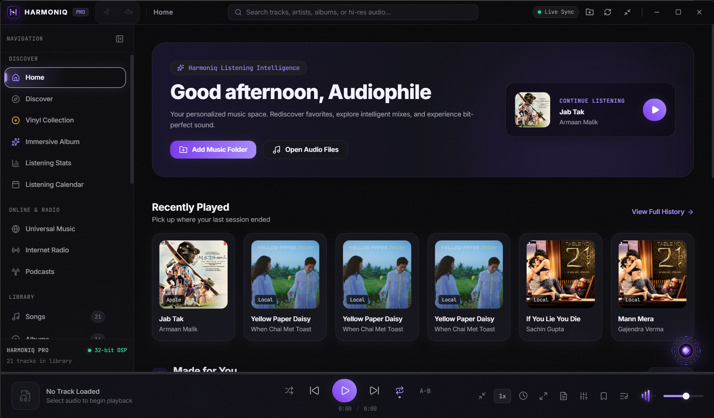
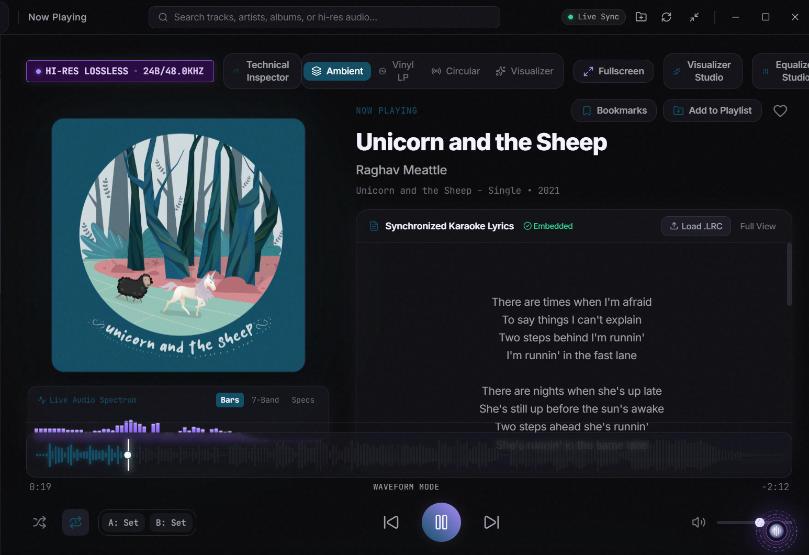
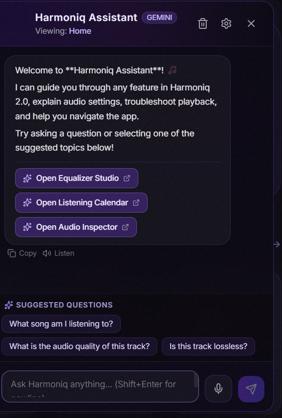
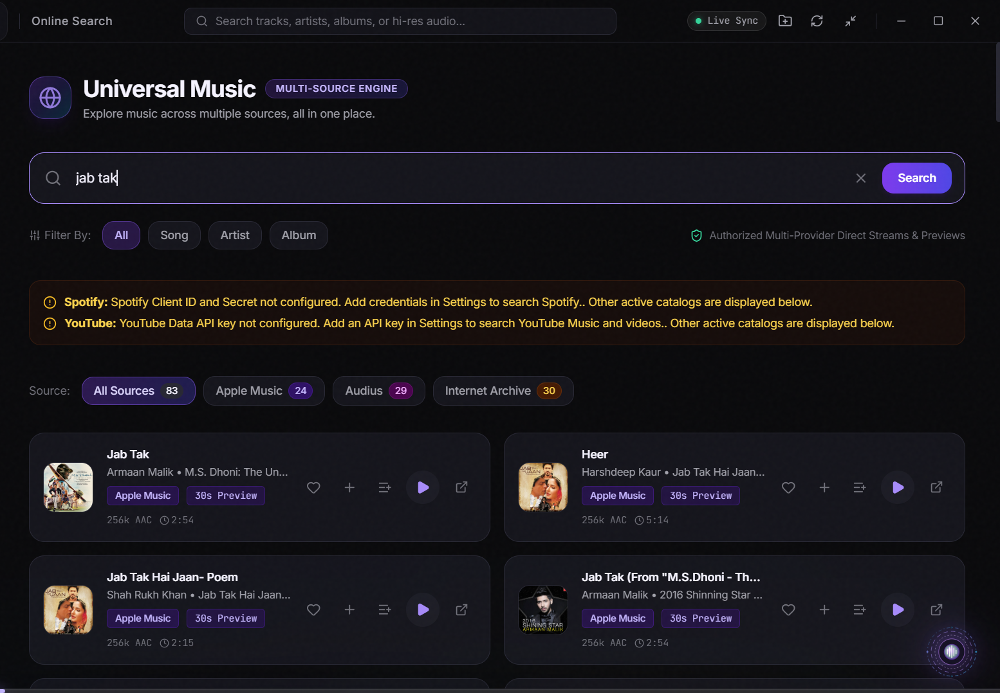
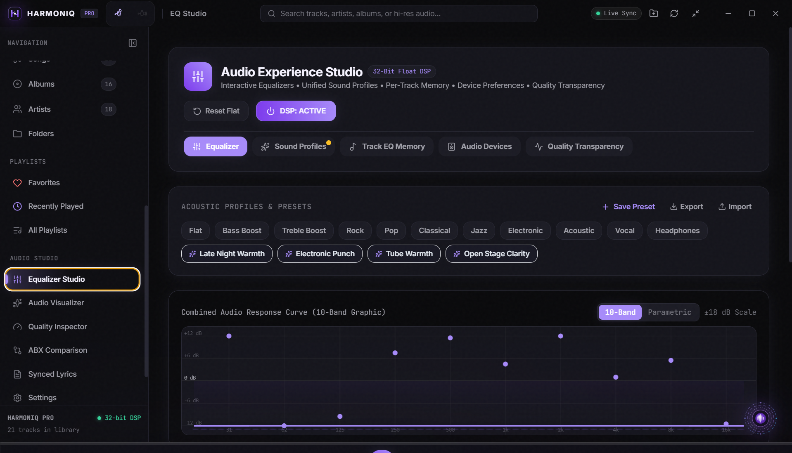
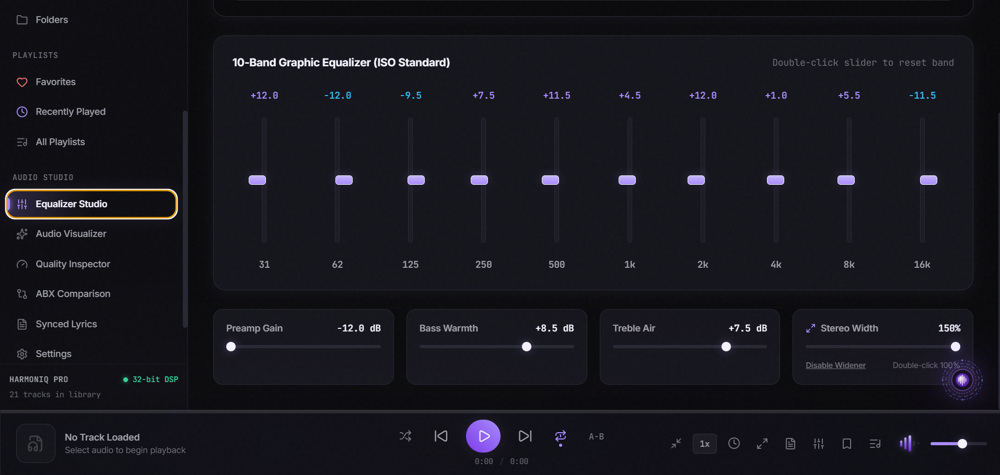
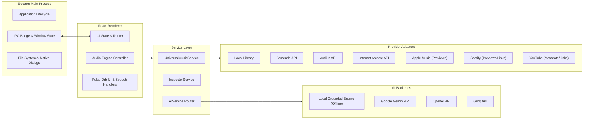

# Harmoniq 2.0

---

## 📖 Overview

**Harmoniq** is a Windows‑only desktop audio player combining local playback, a modular Web Audio DSP pipeline, and an AI‑powered voice assistant (Pulse Orb). Built with **Electron**, **React**, **TypeScript**, and **Vite**.

---

## 🚀 Quick Links

[Features](#features) • [Architecture](#architecture) • [Installation & Development](#installation--development) • [Security & Limitations](#security--limitations) • [License & Contribution](#license--contribution)

---

## 📸 Screenshots

| | |
|---|---|
|  | *Now‑playing UI with visualizer* |
|  | *AI voice assistant panel* |
|  | *Universal Music provider search* |
|  | *10‑band graphic EQ* |
|  | *Parametric filters* |

---

## ✨ Features

### Music Library & Playback
- **Local Playback:** Full-track playback for local audio files in supported containers.
- **Universal Music Providers:**
  - **Jamendo:** Full-track streaming for eligible catalog tracks via authorized stream URLs.
  - **Audius:** Full-track streaming for available tracks.
  - **Internet Archive:** Full-track playback for supported, available archive audio items.
  - **Apple Music:** 30-second previews only (no full-track playback implementation).
  - **Spotify:** 30-second previews when available; otherwise external web links (no full-track playback implementation).
  - **YouTube:** Search, metadata discovery, and external video links only (no direct audio extraction or stream playback).
- **Library Organization:** Tokenized search, playlist creation, multi-queue management, and playback history tracking.

### Audio Engineering & DSP
- **Graphic & Parametric Equalizers:** Standard 10-band graphic equalizer alongside up to 12 configurable parametric peaking and shelving filters implemented using Web Audio `BiquadFilterNode`.
- **Dynamics Processing:** Web Audio `DynamicsCompressorNode` providing soft-knee compression with real-time gain-reduction monitoring (designed for level management; not a guaranteed brick-wall or true-peak limiter, and does not guarantee prevention of all digital clipping).
- **Audio Quality Inspector:** Evaluates source metadata, container specs, active DSP processing, and stream parameters. Audio processing operates via Chromium/Web Audio in Windows Shared Audio Mode. The application does not currently implement WASAPI Exclusive output, and does not claim or verify bit-perfect hardware playback.
- **Visualizer & Spectrum:** Real-time FFT spectrum visualizer via Web Audio `AnalyserNode` and reactive Pulse Orb animations.

### AI & Voice (Pulse Orb)
- **Multi-Backend Architecture:**
  - **Local Grounded Engine:** Offline knowledge base indexing 23 Harmoniq features, generating navigation shortcuts and in-app instructions without external network calls.
  - **Cloud LLM Backends:** Integrations for Google Gemini (`gemini-1.5-flash`), OpenAI (`gpt-4o-mini`), and Groq (`llama-3.1-8b-instant`). These require user-provided API keys and communicate over external network APIs.
- **Voice Input (Speech-to-Text):** Utilizes the browser Web Speech API. Audio transcription may be transmitted to remote recognition services by the underlying browser engine; it is not an offline speech recognizer.
- **Voice Output (Text-to-Speech):** Utilizes available local system voices via the Web Speech Synthesis API, functioning offline regardless of the selected AI backend.

### Windows Integration
- **Audio Output:** Routes audio through Chromium/Web Audio into the standard Windows Shared Audio Mode endpoint.
- **Media Controls:** Integrates with Windows System Media Transport Controls (SMTC) for taskbar playback controls, thumbnail toolbars, and media key handling.
- **Desktop Behaviors:** Single-instance application locking, draggable window controls, and file-association handling for common audio formats.

---

## 🏗️ Architecture

```mermaid
flowchart LR
    Source["Audio Source (Local File / Stream URL)"] --> Decode["Web Audio Decoding (HTML5 Audio / DecodeAudioData)"]
    Decode --> Preamp["GainNode (Preamp & ReplayGain)"]
    Preamp --> GEQ["10-Band Graphic EQ (BiquadFilterNode)"]
    GEQ --> PEQ["Parametric EQ (Up to 12 Biquad Filters)"]
    PEQ --> Comp["DynamicsCompressorNode (Soft-Knee Compression)"]
    Comp --> FFT["AnalyserNode (FFT Spectrum)"]
    FFT --> Destination["AudioDestinationNode"]
    Destination -->|"Windows Shared Audio Mode"| Endpoint["System Audio Output Device"]
```

---

## 🛠️ Installation & Development

### Verified Build Commands

The following scripts are defined in `package.json`:

| Command | Action | Implementation Reference |
|---|---|---|
| `npm install` | Install project dependencies | Root `package.json` |
| `npm run dev` | Launch Vite development server for renderer | `vite` |
| `npm run build` | Typecheck and build renderer bundle | `tsc && vite build` |
| `npm run build:electron` | Compile Electron TypeScript files | `tsc -p tsconfig.electron.json` |
| `npm test` | Run test suite with Vitest | `vitest run` |
| `npm run dist` | Compile and package Windows NSIS installer and portable executable | `electron-builder --win` |

> **Environment Note:** `package.json` does not specify `engines.node` or `engines.npm` constraints. The project was verified in a tested environment of Node.js v24.20.0 with npm v10 (Node.js v18+ is referenced in developer documentation).

---

## 🔒 Security & Limitations

- **Binary Signing:** Windows distribution builds produced by `npm run dist` are currently unsigned; Windows SmartScreen or antivirus tools may flag the executable as coming from an unknown publisher.
- **Audio Output Mode:** All audio output is handled via Chromium/Web Audio in Windows Shared Audio Mode. The application does not implement WASAPI Exclusive output or direct hardware control, and does not claim or verify bit-perfect playback at the hardware level.
- **Dynamics Compressor:** The dynamics processor uses Web Audio's standard `DynamicsCompressorNode` for soft-knee gain reduction and monitoring. It is not a brick-wall or true-peak limiter, and does not guarantee complete elimination of digital clipping.
- **Universal Music Providers:** Streaming is subject to provider availability and terms. Full-track streaming is implemented only for eligible Jamendo, Audius, and Internet Archive items; Apple Music is restricted to 30-second previews, Spotify to previews/links, and YouTube to metadata/links. The application does not offer unrestricted access to commercial streaming catalogs or unauthorized stream extraction.
- **Network & Privacy:** Local library playback operates entirely offline. External network requests occur when using Universal Music providers, cloud AI backends (Gemini, OpenAI, Groq), and Web Speech API speech-to-text recognition. Cloud LLMs require user-provided API keys.
- **Benchmark Qualifications:** Library benchmark metrics (such as ~13 ms average query times across 10,001 items) were measured against in-memory synthetic track objects after pre-indexing, and do not represent initial cold-scan filesystem traversal times.

---

## 📄 License & Contribution

- **License:** Not yet specified. No `LICENSE` file currently exists in the repository.
- **Contributing:** No formal `CONTRIBUTING.md` guidelines are currently established.

---

*Technical reconciliation reference: [Provider & AI Capabilities](docs/README_PROVIDER_AI_RECONCILIATION.md).*
