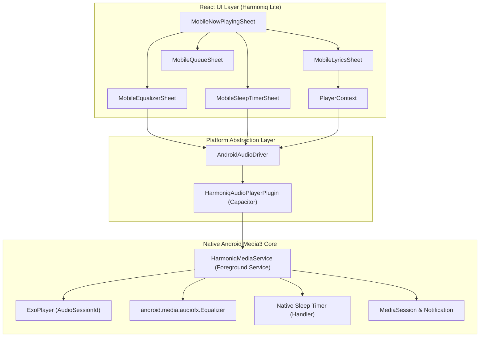

# HARMONIQ LITE — PHASE 3C IMPLEMENTATION REPORT
## Android Audio Features, Hardware Equalizer, Sleep Timer & Synchronized Lyrics

**Date:** November 22, 2026
**Application ID:** `com.bytecraft.harmoniqlite`
**Target Platform:** Android (Capacitor 8 + AndroidX Media3 ExoPlayer)
**Repository Branch:** `feature/harmoniq-lite-android`
**Repository Root:** `C:/Users/a2301/Documents/harmonic project/Harmoniq`

---

## 1. Executive Summary

Phase 3C establishes the advanced mobile audio and media experience for **Harmoniq Lite**, completing the audio features suite while preserving the native Media3 playback architecture established in previous phases:
1. **Real Android Hardware Equalizer (AudioFX):** Built using `android.media.audiofx.Equalizer` attached to ExoPlayer's native `audioSessionId`. Features dynamic hardware band querying, customizable band gains (-15 dB to +15 dB), standard presets (Flat, Bass Boost, Vocal, Rock, Pop, Classical, Jazz, Electronic), reset to flat, and non-crashing fallback on unsupported hardware.
2. **Direct Stream / Bit-Perfect Transparency:** Added clear user notifications whenever audio effects are active, noting that Direct Stream / Bit-Perfect processing is bypassed while effects process audio.
3. **Native Background Sleep Timer:** Designed and built in the Android foreground media service (`HarmoniqMediaService.java`). Utilizes native `Handler` and `SystemClock.elapsedRealtime()` to execute reliably during screen lock and WebView suspension. On expiration, pauses ExoPlayer and updates Android MediaSession cleanly.
4. **Millisecond-Accurate Synchronized Lyrics:** Full-featured bottom sheet with synced LRC line highlighting, auto-scrolling to active line, manual scroll override (pauses auto-scroll for 4 seconds upon user interaction), tap-to-seek, plain text fallback, and empty-state messaging.
5. **Unified Playback Modes:** Native ExoPlayer shuffle and repeat ('off', 'all', 'one') synced bidirectionally between the native service and React state.
6. **Now Playing Enhancements:** Integrated Shuffle and Repeat buttons directly into the playback row, and introduced an action bar featuring direct access to Lyrics, Equalizer, Sleep Timer, and Queue.
7. **Complete Desktop Isolation:** Zero disruption to the Windows desktop Electron player, Web Audio DSP engine, or desktop test suite.

---

## 2. Architecture & Design Principles

### 2.1 Hardware Equalizer vs Desktop Web Audio DSP
Unlike desktop Harmoniq which processes digital audio via the Web Audio API DSP pipeline, Harmoniq Lite delegates equalizing directly to Android's hardware/OS audio framework using `android.media.audiofx.Equalizer`.
- **Session Binding:** Bound to `mPlayer.getAudioSessionId()`, applying gain changes directly to the hardware audio output buffer.
- **Dynamic Band Mapping:** Never hardcodes 10 bands. Instead, it queries `getNumberOfBands()` and `getCenterFreq()` from the active device. Typical Android devices expose 5 bands (60 Hz, 230 Hz, 910 Hz, 3.6 kHz, 14 kHz).
- **Preset Adaptation:** Maps standard preset profiles across the available hardware bands with proportional interpolation.
- **Graceful Unsupported Handling:** On Android devices or ROMs where AudioFX is unavailable or rejected by vendor drivers, catches exceptions cleanly and returns a safe unsupported flag without crashing.
- **Transparency Notice:** When EQ is enabled, the UI explicitly highlights: *"Audio effects active: Direct Stream / Bit-Perfect bypassed"*.

### 2.2 Native Sleep Timer & Screen-Off Background Reliability
Android WebViews are throttled or suspended when the device screen locks or when switching applications. Implementing sleep timers purely in JavaScript `setInterval` causes delayed execution or missed timers.
- **Native Execution:** Timer countdown logic runs in `HarmoniqMediaService.java` using an Android `Handler` and `SystemClock.elapsedRealtime()`.
- **Foreground WakeLock:** `HarmoniqMediaService` holds `WAKE_MODE_LOCAL` and runs as a foreground service with active media notification.
- **Clean Teardown:** Upon expiration, `triggerSleepTimerExpiration()` pauses ExoPlayer, synchronizes the MediaSession state, updates the notification, and notifies the React frontend via `@PluginMethod` event `sleepTimerExpired`.

### 2.3 Synchronized LRC & Lyrics Engine
- **Accurate Parsing:** `LyricsService.parseLrc()` decodes standard timestamps `[mm:ss.xx]` and `[mm:ss.xxx]`, supports multi-timestamp lyric lines (e.g., repeated choruses), and respects global time offsets `[offset:+/-ms]`.
- **Dynamic Auto-Scroll:** Centers the active lyric line smoothly during playback.
- **Manual Scroll Override:** Detecting user touch/scroll gestures temporarily suspends auto-scrolling for 4 seconds, allowing users to read ahead or review previous lyrics without the UI snapping back abruptly.
- **Tap to Seek:** Tapping any lyric line seeks playback directly to that timestamp.
- **Metadata Cleaning:** Strips bracketed tags, remaster metadata, and feature credits (`cleanTrackTitle`) for robust lyric lookups.

---

## 3. Modified and Created Files

| File | Type | Description |
|---|---|---|
| [HarmoniqMediaService.java](file:///C:/Users/a2301/Documents/harmonic%20project/Harmoniq/android/app/src/main/java/com/bytecraft/harmoniqlite/HarmoniqMediaService.java) | Native Java | Added `android.media.audiofx.Equalizer`, native sleep timer `Handler`, and shuffle/repeat modes |
| [HarmoniqAudioPlayerPlugin.java](file:///C:/Users/a2301/Documents/harmonic%20project/Harmoniq/android/app/src/main/java/com/bytecraft/harmoniqlite/HarmoniqAudioPlayerPlugin.java) | Native Java | Added Capacitor bridge methods for EQ parameters, band gain, presets, sleep timer, and sleep timer event |
| [types.ts](file:///C:/Users/a2301/Documents/harmonic%20project/Harmoniq/src/services/platform/types.ts) | TypeScript | Added `EqualizerBand`, `EqualizerParameters`, `NativeSleepTimerStatus`, and `SleepTimerExpiredListener` interfaces |
| [IAudioDriver.ts](file:///C:/Users/a2301/Documents/harmonic%20project/Harmoniq/src/services/platform/IAudioDriver.ts) | TypeScript | Declared equalizer, sleep timer, shuffle, repeat, and skip methods on audio driver interface |
| [AndroidAudioDriver.ts](file:///C:/Users/a2301/Documents/harmonic%20project/Harmoniq/src/services/platform/android/AndroidAudioDriver.ts) | TypeScript | Implemented native Capacitor plugin bindings for EQ, sleep timer, shuffle, repeat, and snapshot recovery |
| [PlayerContext.tsx](file:///C:/Users/a2301/Documents/harmonic%20project/Harmoniq/src/context/PlayerContext.tsx) | TypeScript | Connected shuffle/repeat toggles, sleep timer lifecycle, and foreground snapshot restoration |
| [MobileLyricsSheet.tsx](file:///C:/Users/a2301/Documents/harmonic%20project/Harmoniq/src/components/mobile/lyrics/MobileLyricsSheet.tsx) | React / TSX | New lyrics bottom sheet with synchronized scrolling, manual scroll pause (4s), and tap-to-seek |
| [MobileEqualizerSheet.tsx](file:///C:/Users/a2301/Documents/harmonic%20project/Harmoniq/src/components/mobile/dsp/MobileEqualizerSheet.tsx) | React / TSX | New hardware equalizer sheet with master switch, preset chips, dynamic band sliders, and reset to flat |
| [MobileSleepTimerSheet.tsx](file:///C:/Users/a2301/Documents/harmonic%20project/Harmoniq/src/components/mobile/layout/MobileSleepTimerSheet.tsx) | React / TSX | New sleep timer sheet with quick presets (5-60m), custom duration input, countdown, and native timer cancel |
| [MobileNowPlayingSheet.tsx](file:///C:/Users/a2301/Documents/harmonic%20project/Harmoniq/src/components/mobile/layout/MobileNowPlayingSheet.tsx) | React / TSX | Enhanced Now Playing layout with Shuffle/Repeat buttons and 4-item Action Bar (Lyrics, EQ, Sleep, Queue) |
| [MobileQueueSheet.tsx](file:///C:/Users/a2301/Documents/harmonic%20project/Harmoniq/src/components/mobile/layout/MobileQueueSheet.tsx) | React / TSX | Updated back handler priority to 2 to properly nest above expanded Now Playing sheet |
| [phase3c_audio_lyrics_eq.test.ts](file:///C:/Users/a2301/Documents/harmonic%20project/Harmoniq/src/test/phase3c_audio_lyrics_eq.test.ts) | Vitest Test | Comprehensive unit and integration test suite covering EQ, sleep timer, lyrics, and desktop isolation |

---

## 4. Hardware Equalizer Specification

### 4.1 Native Equalizer Control Table
| Parameter | Range | Implementation |
|---|---|---|
| Master Toggle | `true` / `false` | `Equalizer.setEnabled(boolean)` |
| Frequency Bands | Hardware-defined (e.g., 5 bands: 60Hz, 230Hz, 910Hz, 3.6kHz, 14kHz) | `Equalizer.getNumberOfBands()`, `Equalizer.getCenterFreq()` |
| Gain Range | Device range (typically -1500 to +1500 millibels / -15 dB to +15 dB) | `Equalizer.setBandLevel(short, short)` |
| Supported Presets | Flat, Bass Boost, Vocal, Rock, Pop, Classical, Jazz, Electronic | Hardware preset mapping + custom band gain distribution |
| Reset to Flat | Reverts all bands to 0 dB | Sets all band levels to 0 and currentPreset to 'Flat' |

---

## 5. Verification & Build Summary

1. **Vitest Unit & Integration Tests:**
   - Command: `npx vitest run src/test/phase3c_audio_lyrics_eq.test.ts`
   - Result: **22 passed (22)** in 15ms.
   - Full Suite: `npm test -- --run`
   - Result: **875 passed (875)** across **75 test suites**.
2. **TypeScript Web Compilation:**
   - Command: `npm run build` (`tsc && vite build`)
   - Result: **Exit Code 0** (2343 modules transformed cleanly).
3. **Desktop Electron Compilation:**
   - Command: `npm run build:electron` (`tsc -p tsconfig.electron.json`)
   - Result: **Exit Code 0**.
4. **Capacitor Android Sync:**
   - Command: `npx cap sync android`
   - Result: Web assets copied and capacitor plugins synced in 0.529s.
5. **Android Debug APK Assembly:**
   - Command: `cd android && .\gradlew.bat assembleDebug`
   - Result: **BUILD SUCCESSFUL** in 3s.
   - APK Output: `android/app/build/outputs/apk/debug/app-debug.apk` (8,473,960 bytes).
