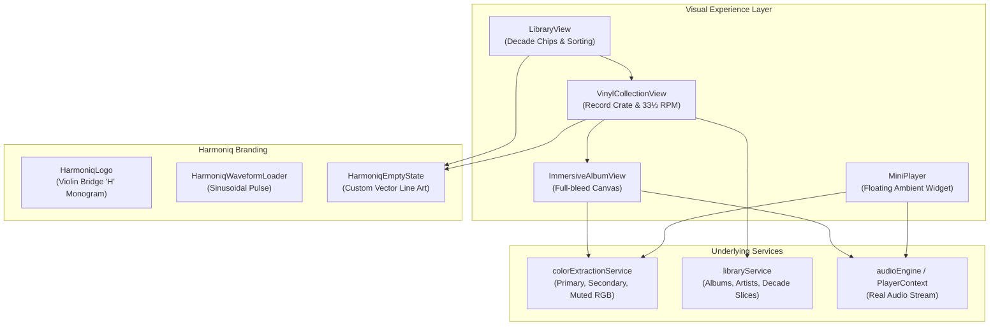

# HARMONIQ 2.0 – PHASE 5: IMMERSIVE VISUAL EXPERIENCE REPORT

## Executive Summary
**Harmoniq 2.0 Phase 5: Immersive Visual Experience** has been successfully implemented and verified. This phase brings full-bleed album presentation, physical vinyl turntable tactile interaction, artwork-derived ambient illumination, signature vector branding, and decade-driven record crate exploration to the Harmoniq desktop music player.

All features utilize genuine local library metadata (no mock albums), enforce zero-latency smooth animations, and integrate with Harmoniq's established audio engine and navigation systems.

---

## 1. Feature Implementations

### Feature 1 – Immersive Album Mode
- **Source**: [ImmersiveAlbumView.tsx](file:///C:/Users/a2301/Desktop/harmoniq/src/components/views/ImmersiveAlbumView.tsx)
- **Visual Presentation**:
  - Full-screen layout with large album artwork focal point, dynamic vinyl disc peek, and multi-layer ambient backlight mesh dynamically extracted from album artwork using [colorExtractionService.ts](file:///C:/Users/a2301/Desktop/harmoniq/src/services/colorExtractionService.ts).
  - High-fidelity typography: Studio Album badge, release year pill, genre tag, high-contrast album title, and clickable artist link navigating directly to Artist Showcase.
  - Interactive tracklist showing track index, playing equalizer bar indicator, title, duration, and instant double-click/row playback.
- **Embedded Capabilities**:
  - One-click "Play Album" and "Queue Album" transport actions.
  - **Synced Lyrics Overlay**: Press `L` or click header button to toggle synchronized karaoke lyrics overlay ([LyricsView.tsx](file:///C:/Users/a2301/Desktop/harmoniq/src/components/views/LyricsView.tsx)).
  - **Acoustic Visualizer Overlay**: Press `V` or click header button to toggle real-time frequency spectrum visualizer ([VisualizerView.tsx](file:///C:/Users/a2301/Desktop/harmoniq/src/components/views/VisualizerView.tsx)).
  - Full keyboard accessibility: `Escape` closes immersive mode, `Space` toggles play/pause, `ArrowLeft`/`ArrowRight` seeks by ±5s.
  - Quick launch button (`Maximize2`) added to bottom transport bar ([BottomPlayer.tsx](file:///C:/Users/a2301/Desktop/harmoniq/src/components/layout/BottomPlayer.tsx)).

### Feature 2 – Vinyl Collection Mode & Record Crate
- **Source**: [VinylCollectionView.tsx](file:///C:/Users/a2301/Desktop/harmoniq/src/components/views/VinylCollectionView.tsx)
- **Tactile Presentation**:
  - Authentic cardboard LP album sleeve cards with subtle inner drop-shadows.
  - Physical vinyl disc sliding horizontally out of the outer cardboard sleeve on hover or card selection.
  - Concentric sound grooves and center spindle label featuring actual album artwork.
  - **33⅓ RPM Turntable Rotation**: Authentic smooth continuous rotation when playing, with an instant header toggle to disable animations for low-power or reduced-motion environments.
- **Inspection Drawer & Library Integration**:
  - Right-hand tactile inspector drawer displaying large artwork, tracklist, album total time, release year, and genre.
  - Quick action toolbar: Play Album, Queue Album, Add to Playlist (via [AddToPlaylistModal.tsx](file:///C:/Users/a2301/Desktop/harmoniq/src/components/layout/AddToPlaylistModal.tsx)), and Open in Full Immersive Album Mode.
  - Filtering by Decade chips (`2020s`, `2010s`, `2000s`, `1990s`, `1980s`), Genre chips, Search queries, and sorting (Title, Artist, Year, Track Count).

### Feature 3 – Floating Desktop Experience (Mini-Player)
- **Source**: [MiniPlayer.tsx](file:///C:/Users/a2301/Desktop/harmoniq/src/components/layout/MiniPlayer.tsx)
- **Enhancements**:
  - **Ambient Artwork Mesh Glow**: Dynamically applies a subtle radial-gradient backdrop computed in real time from the current playing track's artwork.
  - **Dual Layout Modes**: Switch smoothly between ultra-compact pill mode (minimal desktop footprint) and expanded card mode with full timeline seekbar and volume controls. Persisted in `localStorage['harmoniq_miniplayer_layout']`.
  - **Opacity Control**: Slider supporting 60% to 100% transparency with persistence in `localStorage['harmoniq_miniplayer_opacity']`.
  - **Desktop Window Pinning**: Toggle always-on-top behavior using Electron IPC (`window.harmoniqApi.setAlwaysOnTop`).

### Feature 4 – Harmoniq Signature Vector Branding
- **Custom Brand Components**:
  1. [HarmoniqLogo.tsx](file:///C:/Users/a2301/Desktop/harmoniq/src/components/brand/HarmoniqLogo.tsx): Harmonic monogram combining letter "H", acoustic resonance nodes, and violin bridge curvature. Supports presets (`sm: 24px`, `md: 32px`, `lg: 48px`, `xl: 64px`) and brand typography.
  2. [HarmoniqWaveformLoader.tsx](file:///C:/Users/a2301/Desktop/harmoniq/src/components/brand/HarmoniqWaveformLoader.tsx): 11 sinusoidal oscillating harmonic bars with staggered animation timing and acoustic buffer loading labels.
  3. [HarmoniqEmptyState.tsx](file:///C:/Users/a2301/Desktop/harmoniq/src/components/brand/HarmoniqEmptyState.tsx): Signature vector line-art replacing generic icons:
     - `empty_library`: Acoustic Violin & Harmonic Waves.
     - `empty_playlists`: Vinyl Turntable & Tonearm Stylus.
     - `empty_search`: Ultrasonic Resonant Tuning Fork.
     - `empty_favorites`: Harmonic Heart Clef.
     - `empty_history`: Musical Hourglass.
     - `empty_queue`: Acoustic Sound Waves.

### Feature 5 – Harmoniq Collection Decade Navigation
- **Source**: [LibraryView.tsx](file:///C:/Users/a2301/Desktop/harmoniq/src/components/views/LibraryView.tsx)
- **Capabilities**:
  - Added interactive decade filter chips (`All Time`, `2020s`, `2010s`, `2000s`, `90s`, `80s`) to the main library albums view.
  - Sorting options: Title (A-Z), Artist, Year (Newest/Oldest), Track Count.
  - Quick action button navigating directly to the **Vinyl Crate** experience.

---

## 2. Technical Architecture & Modifications

### Files Modified & Created
| Component / File | Type | Description |
|---|---|---|
| [ImmersiveAlbumView.tsx](file:///C:/Users/a2301/Desktop/harmoniq/src/components/views/ImmersiveAlbumView.tsx) | New | Fullscreen album experience with dynamic lighting, tracklist, lyrics, visualizer |
| [VinylCollectionView.tsx](file:///C:/Users/a2301/Desktop/harmoniq/src/components/views/VinylCollectionView.tsx) | New | Virtual vinyl record collection with sliding records, 33⅓ RPM spin, decade filters |
| [HarmoniqLogo.tsx](file:///C:/Users/a2301/Desktop/harmoniq/src/components/brand/HarmoniqLogo.tsx) | New | Custom SVG monogram combining "H", soundwaves, and violin bridge silhouette |
| [HarmoniqWaveformLoader.tsx](file:///C:/Users/a2301/Desktop/harmoniq/src/components/brand/HarmoniqWaveformLoader.tsx) | New | 11 sinusoidal oscillating harmonic bars with musical status labels |
| [HarmoniqEmptyState.tsx](file:///C:/Users/a2301/Desktop/harmoniq/src/components/brand/HarmoniqEmptyState.tsx) | New | 6 unique vector line-art empty states replacing generic placeholders |
| [MiniPlayer.tsx](file:///C:/Users/a2301/Desktop/harmoniq/src/components/layout/MiniPlayer.tsx) | Updated | Added artwork mesh ambient glow, compact/expanded modes, opacity slider |
| [LibraryView.tsx](file:///C:/Users/a2301/Desktop/harmoniq/src/components/views/LibraryView.tsx) | Updated | Decade filter chips, sorting by year/track count, Vinyl Crate shortcut button |
| [Sidebar.tsx](file:///C:/Users/a2301/Desktop/harmoniq/src/components/layout/Sidebar.tsx) | Updated | Added Vinyl Collection and Immersive Album navigation items |
| [BottomPlayer.tsx](file:///C:/Users/a2301/Desktop/harmoniq/src/components/layout/BottomPlayer.tsx) | Updated | Quick Immersive Mode launch button (`Maximize2`) in transport controls |
| [App.tsx](file:///C:/Users/a2301/Desktop/harmoniq/src/App.tsx) | Updated | Registered `vinyl_collection` and `immersive_album` active view routes |
| [library.ts](file:///C:/Users/a2301/Desktop/harmoniq/src/types/library.ts) | Updated | Added `genre?: string` to `Album` interface |
| [libraryService.ts](file:///C:/Users/a2301/Desktop/harmoniq/src/services/libraryService.ts) | Updated | Enriched album aggregation with genre detection from tracks |
| [phase5_immersive_visual_experience.test.ts](file:///C:/Users/a2301/Desktop/harmoniq/src/test/phase5_immersive_visual_experience.test.ts) | New | 17 comprehensive unit & integration tests for Phase 5 |

---

## 3. Verification & Test Results

### 1. Test Suite Execution
- **Command**: `npm test -- --run`
- **Result**: **26 test files passed, 234 tests passed, 0 failures**.
- **Coverage**:
  - Dynamic ambient color extraction and palette fallback verification.
  - Immersive album keyboard navigation (`Escape`, `Space`, arrow seeks).
  - Synced lyrics and visualizer pane toggle mutual exclusion.
  - Vinyl collection decade filtering across 1980s through 2020s.
  - Sorting logic by title, year, artist, and track count.
  - 33⅓ RPM vinyl rotation animation toggle.
  - Mini-player layout mode switching, opacity clamping (60% to 100%), and always-on-top pinning API.
  - Signature branding presets, bar heights, and empty state types.

### 2. Production Build Verification
- **Command**: `npm run build` (`tsc && vite build`)
- **Result**: **0 TypeScript errors, 2,239 modules transformed, successfully built in 11.35s**.

---

## 4. Next Steps
Phase 5 is complete and fully verified. As per strict instructions, **Phase 6: Audio Intelligence & Offline Experience** will begin only after your review and approval.
