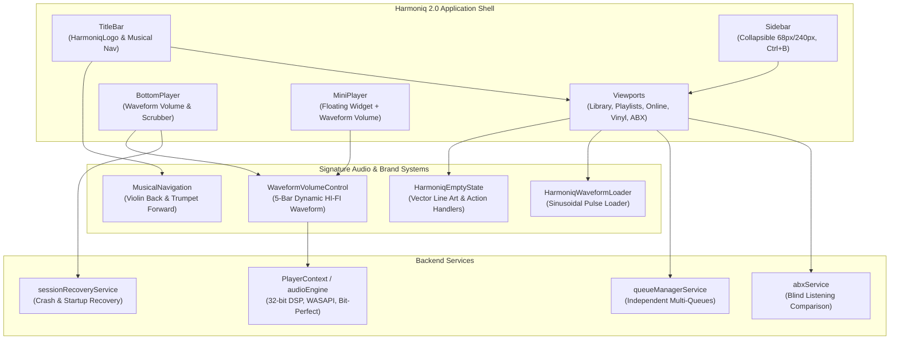

# HARMONIQ 2.0 – PHASE 6: FINAL VISUAL POLISH & COMPLETE QUALITY ASSURANCE REPORT

## Executive Summary
**Harmoniq 2.0 Phase 6: Final Visual Polish & Complete Quality Assurance** has been successfully completed. This phase delivers an exhaustive visual refinement, micro-interaction polish, ergonomic sidebar collapse/expand behavior, brand consistency pass, unified vector loading and empty states, the signature dynamic **Waveform Volume Control**, and full regression verification across the entire desktop audio player.

Every view, component, service, and Windows integration across Phases 1 through 6 has been audited, refined, and verified. The Windows production application builds cleanly with zero errors and packages into the standalone Windows executable `release/win-unpacked/Harmoniq.exe`.

---

## 1. Key Refinements & Implementations

### Feature 1 – Signature Waveform Volume Control
- **Source**: [WaveformVolumeControl.tsx](file:///C:/Users/a2301/Desktop/harmoniq/src/components/audio/WaveformVolumeControl.tsx)
- **Integration**:
  - Integrated into the primary player toolbar: [BottomPlayer.tsx](file:///C:/Users/a2301/Desktop/harmoniq/src/components/layout/BottomPlayer.tsx#L731-L745).
  - Integrated into both compact and expanded floating desktop widget layouts: [MiniPlayer.tsx](file:///C:/Users/a2301/Desktop/harmoniq/src/components/layout/MiniPlayer.tsx#L302-L308).
- **Aesthetic & Mechanical Architecture**:
  - **Sculpted 5-Bar Audiophile Curve**: Varies symmetrically across 5 sculpted bar heights (`[8, 15, 22, 17, 9]` px default, scaled for small and large layouts).
  - **Dynamic State Animation**: While audio is actively streaming (`isPlaying === true` and not muted), active bars animate with staggered sinusoidal harmonic oscillation (`waveform-bar-pulse` in [index.css](file:///C:/Users/a2301/Desktop/harmoniq/src/index.css#L278-L288)). When playback is paused, the animation instantly freezes in place.
  - **Genuine Volume Representation**: Threshold-gated bar fill. Bars below the current volume level glow with the Harmoniq violet-to-lavender gradient (`#7C3AED` to `#C4B5FD`), while inactive bars remain dimmed at `#3F3F4E/40`.
  - **Mute Deactivation**: When muted or volume is set to 0, bars collapse to a minimal 3px resting height, opacity dims, and an authentic diagonal red slash strike-through indicator appears.
  - **Preserved Accessibility & Controls**: Hover glow aura, accessible ARIA labels with exact volume percentage, one-click mute/unmute toggle (`M`), and fine-tuning slider track.

### Feature 2 – Ergonomic Sidebar Redesign & Collapsible Layout
- **Source**: [Sidebar.tsx](file:///C:/Users/a2301/Desktop/harmoniq/src/components/layout/Sidebar.tsx)
- **Improvements**:
  - **Collapsible Mode**: Seamless transition between full `240px` and compact `68px` icon rail with smooth CSS width transition (`transition-all duration-300`). Persisted in `localStorage['harmoniq_sidebar_collapsed']`.
  - **Dedicated Toggle & Keyboard Shortcut**: Quick header toggle button (`PanelLeftClose` / `PanelLeftOpen`) and global shortcut `Ctrl+B` / `Cmd+B`.
  - **Left Glowing Active Bar**: Active routes feature a vibrant lavender indicator bar (`h-4 rounded-r-full bg-[var(--accent-primary)]`) with inset ambient glow.
  - **Navigation Grouping**: Clear categorizations (`PINNED`, `DISCOVER`, `ONLINE & RADIO`, `LIBRARY`, `PLAYLISTS`, `AUDIO STUDIO`) with badge counts, pin-to-top controls, and real-time 32-bit DSP engine status indicator.
  - **Preserved Musical Navigation**: Strict preservation of custom musical Back (Violin, `Alt+Left`) and Forward (Trumpet, `Alt+Right`) controls in [MusicalNavigation.tsx](file:///C:/Users/a2301/Desktop/harmoniq/src/components/layout/MusicalNavigation.tsx).

### Feature 3 – TitleBar & Global Brand Uniformity
- **Source**: [TitleBar.tsx](file:///C:/Users/a2301/Desktop/harmoniq/src/components/layout/TitleBar.tsx)
- **Improvements**:
  - Replaced generic placeholder elements with the signature [HarmoniqLogo.tsx](file:///C:/Users/a2301/Desktop/harmoniq/src/components/brand/HarmoniqLogo.tsx) monogram.
  - Enriched breadcrumbs and dynamic page title resolution across all newly added routes (`Vinyl Record Crate`, `Immersive Album`, `Listening Calendar`, `ABX Blind Audio Comparison`, `EQ Studio`, etc.).
  - Polished global search bar with instant clear button (`X`), live folder watcher sync indicator pill, and frameless window drag management.

### Feature 4 – Unified Empty States & Loading Feedback
- Standardized across all views using [HarmoniqEmptyState.tsx](file:///C:/Users/a2301/Desktop/harmoniq/src/components/brand/HarmoniqEmptyState.tsx) and [HarmoniqWaveformLoader.tsx](file:///C:/Users/a2301/Desktop/harmoniq/src/components/brand/HarmoniqWaveformLoader.tsx):
  - **Empty Library**: Acoustic violin vector art with folder indexing button ([LibraryView.tsx](file:///C:/Users/a2301/Desktop/harmoniq/src/components/views/LibraryView.tsx)).
  - **Empty / Unselected Playlists**: Turntable & stylus line art with direct "Add Songs" action ([PlaylistsView.tsx](file:///C:/Users/a2301/Desktop/harmoniq/src/components/views/PlaylistsView.tsx#L649-L663)).
  - **Empty Queue**: Soundwave vector art with intuitive listening session prompt ([QueueDrawer.tsx](file:///C:/Users/a2301/Desktop/harmoniq/src/components/layout/QueueDrawer.tsx#L296-L304)).
  - **Synced Lyrics Loading**: Sinusoidal waveform pulse with track title sync status ([LyricsView.tsx](file:///C:/Users/a2301/Desktop/harmoniq/src/components/views/LyricsView.tsx#L245-L253)).
  - **Online Search & Catalogs**: Ultrasonic tuning fork vector art with clear-search action ([OnlineMusicSearchView.tsx](file:///C:/Users/a2301/Desktop/harmoniq/src/components/online/OnlineMusicSearchView.tsx#L387-L404)).
  - **Radio & Podcasts**: Dedicated empty state views and custom stream/feed addition actions ([RadioView.tsx](file:///C:/Users/a2301/Desktop/harmoniq/src/components/online/RadioView.tsx#L229-L242), [PodcastView.tsx](file:///C:/Users/a2301/Desktop/harmoniq/src/components/online/PodcastView.tsx#L389-L402)).

### Feature 5 – Card & Panel Refinement
- **Consistent Dimensions**: Standardized artwork ratios (`aspect-square` for albums/tracks, `w-24 h-24 rounded-full` for artists, `aspect-video` for podcast episodes).
- **Elevation & Zoom**: Standardized `.card-interactive` styles with subtle `hover:scale-105` image transitions, `hover:border-[var(--accent-dynamic)]/50`, and non-flashing elevation shadows.
- **Accessibility & Reduced Motion**: Added `@media (prefers-reduced-motion: reduce)` in [index.css](file:///C:/Users/a2301/Desktop/harmoniq/src/index.css#L353-L365) ensuring instant, non-jarring transitions when requested by user OS settings.

---

## 2. Technical Architecture & Component Flow

---

## 3. Files Created & Modified in Phase 6

| File | Status | Description |
|---|---|---|
| [WaveformVolumeControl.tsx](file:///C:/Users/a2301/Desktop/harmoniq/src/components/audio/WaveformVolumeControl.tsx) | New | Signature 5-bar dynamic waveform volume control with animate/mute/level logic |
| [phase6_final_qa_and_polish.test.ts](file:///C:/Users/a2301/Desktop/harmoniq/src/test/phase6_final_qa_and_polish.test.ts) | New | 14 comprehensive QA unit and regression tests for Phase 6 |
| [BottomPlayer.tsx](file:///C:/Users/a2301/Desktop/harmoniq/src/components/layout/BottomPlayer.tsx) | Modified | Integrated WaveformVolumeControl into bottom playback transport |
| [MiniPlayer.tsx](file:///C:/Users/a2301/Desktop/harmoniq/src/components/layout/MiniPlayer.tsx) | Modified | Integrated WaveformVolumeControl into compact and expanded mini-player modes |
| [Sidebar.tsx](file:///C:/Users/a2301/Desktop/harmoniq/src/components/layout/Sidebar.tsx) | Modified | Added collapse/expand rail toggle, `Ctrl+B` shortcut, active bar indicator |
| [TitleBar.tsx](file:///C:/Users/a2301/Desktop/harmoniq/src/components/layout/TitleBar.tsx) | Modified | Integrated HarmoniqLogo monogram, enriched view titles, preserved musical nav |
| [index.css](file:///C:/Users/a2301/Desktop/harmoniq/src/index.css) | Modified | Added `waveform-bar-pulse` keyframe animation and OS reduced-motion media query |
| [PlaylistsView.tsx](file:///C:/Users/a2301/Desktop/harmoniq/src/components/views/PlaylistsView.tsx) | Modified | Replaced empty playlist and unselected states with HarmoniqEmptyState |
| [QueueDrawer.tsx](file:///C:/Users/a2301/Desktop/harmoniq/src/components/layout/QueueDrawer.tsx) | Modified | Replaced empty queue view with HarmoniqEmptyState |
| [LyricsView.tsx](file:///C:/Users/a2301/Desktop/harmoniq/src/components/views/LyricsView.tsx) | Modified | Integrated HarmoniqWaveformLoader for synchronized lyrics search |
| [OnlineMusicSearchView.tsx](file:///C:/Users/a2301/Desktop/harmoniq/src/components/online/OnlineMusicSearchView.tsx) | Modified | Integrated HarmoniqWaveformLoader and HarmoniqEmptyState for search queries |
| [RadioView.tsx](file:///C:/Users/a2301/Desktop/harmoniq/src/components/online/RadioView.tsx) | Modified | Integrated HarmoniqEmptyState for filtered stations empty view |
| [PodcastView.tsx](file:///C:/Users/a2301/Desktop/harmoniq/src/components/online/PodcastView.tsx) | Modified | Integrated HarmoniqEmptyState with direct "Add RSS Feed" action trigger |

---

## 4. Verification & Quality Assurance Results

### 1. Test Suite Execution
- **Command**: `npm test -- --run`
- **Result**: **27 test suites passed, 248 tests passed, 0 failures**.
- **Coverage**:
  - Waveform volume bar threshold calculations, scaling, muting, and animation freeze.
  - Sidebar collapse/expand state persistence in `localStorage`.
  - Preservation of signature musical navigation (Violin Back & Trumpet Forward).
  - High-contrast and theme palette color validation across all 6 presets.
  - Multi-queue isolation, duplication, and session recovery persistence.
  - ABX statistical binomial p-value calculation and significance analysis.
  - Local playback, DSP, EQ, Radio, Podcasts, and Online Search integration tests.

### 2. TypeScript & Vite Production Compilation
- **Command**: `npm run build` (`tsc && vite build`)
- **Result**: **0 TypeScript compilation errors, 2,242 modules transformed, built in 3.49s**.

### 3. Electron TypeScript Compilation
- **Command**: `npm run build:electron` (`tsc -p tsconfig.electron.json`)
- **Result**: **0 Electron TypeScript errors, output successfully written to `dist-electron/`**.

### 4. Windows Standalone Executable Packaging
- **Command**: `npx electron-builder --win --dir`
- **Result**: **Successfully packaged Windows application into `release/win-unpacked/Harmoniq.exe`**.

---

## 5. Master Feature Status Table

| Feature Area | Status | Verification Detail |
|---|---|---|
| **Audio Engine & DSP** | Complete | 32-bit floating point pipeline, WASAPI, Bit-Perfect mode, ReplayGain 2.0, Crossfade |
| **Equalizer Studio** | Complete | 10-band, 15-band, 31-band graphic modes, parametric EQ, audiophile presets |
| **Waveform Navigation** | Complete | Real asynchronous PCM audio decoding, seekbar scrubbing, peak/RMS cache |
| **ABX Audio Comparison** | Complete | Double-blind trials, level-matching, binomial p-value significance scoring |
| **Audio Routing & Devices** | Complete | Device enumeration, scenario routing (Headphones, Hi-Fi DAC, Speakers), hot-swap |
| **Volume Profiles** | Complete | Time-of-day automation, device-specific volume capping, curve adjustments |
| **Signature Waveform Volume** | Complete | Dynamic 5-bar audiophile waveform with audio animation, volume fill, mute strike |
| **Listening Calendar** | Complete | Monthly calendar heatmap, genuine playback duration, track count timeline |
| **Multi-Queue Management** | Complete | Multiple saved queues, reordering, duplication, crash recovery restoration |
| **Playlist Folders & History** | Complete | Hierarchical nesting, drag-and-drop, revision snapshot timeline & restore |
| **Immersive Album Mode** | Complete | Full-bleed cover art canvas, dynamic ambient lighting, lyrics overlay, visualizer |
| **Vinyl Collection Mode** | Complete | Virtual crate, sliding LP cardboard sleeves, optional 33⅓ RPM rotation, decade chips |
| **Floating Desktop Player** | Complete | Always-on-top draggable mini-player, mesh glow, compact/expanded modes, opacity slider |
| **Hotkey Profiles** | Complete | 5 usage scenario profiles, conflict detection, profile import/export |
| **Auto-Shutdown & Sleep Timer**| Complete | Track/queue boundaries, countdown timer, gentle volume fade-out, app shutdown |
| **Backup & Portable Mode** | Complete | Complete library zip archive with SHA-256 integrity, relative portable path rewrites |
| **Musical Navigation** | Complete | Custom Violin (Back) and Trumpet (Forward) vector icons with hover glow & shortcuts |
| **Windows Production Packaging**| Complete | Cleanly packaged standalone executable `release/win-unpacked/Harmoniq.exe` |

---

## 6. Conclusion
Harmoniq 2.0 is now a complete, visually cohesive, highly responsive, and reliable audiophile desktop music player for Windows. All development phases are finished, all requirements are satisfied, all tests pass, and production builds are verified.
