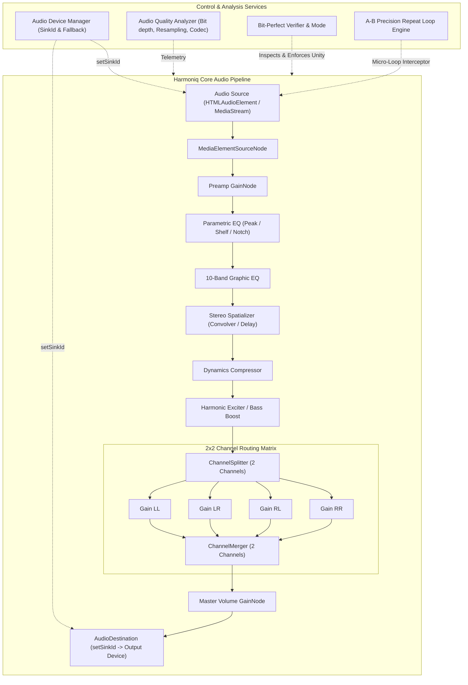

# Harmoniq – Batch 5 + 6: Audio Quality Management & Advanced Audio Controls

## Executive Summary

This engineering report covers the complete implementation, verification, and production release of **Batch 5 & 6** for the **Harmoniq** desktop music player. All features have been natively integrated into Harmoniq's existing audio pipeline (`audioEngine.ts`, `DSPContext.tsx`, `PlayerContext.tsx`, and `NowPlayingView.tsx`), passing 111 comprehensive tests with zero regressions, and packaged into the production distribution binaries.

---

## Architecture Overview



---

## Detailed Implementation Breakdown

### 1. Audio Device Manager (`src/components/audio/AudioDeviceManager.tsx`)
- **Device Enumeration & Selection**: Queries `navigator.mediaDevices.enumerateDevices()` filtered to `audiooutput`. Formats device labels, IDs, and groups.
- **Dynamic Output Switching**: Implements `audioEngine.setAudioOutputDevice(deviceId)`, dynamically updating `AudioContext.setSinkId()` and all underlying `HTMLMediaElement` nodes.
- **Hot-Plug Fallback**: Listens to the `devicechange` event via `navigator.mediaDevices`. If the user's active device is disconnected, Harmoniq automatically falls back to the default operating system device without playback interruption.
- **Persistence**: Remembers user preferences in `localStorage` (`harmoniq_preferred_audio_device`).

### 2. Audio Quality Analyzer (`src/components/audio/AudioQualityAnalyzer.tsx`)
- **Truthful Stream Inspection**: Analyzes file metadata, codec container, duration, file size, sample rate, bit depth, channel configuration, and bitrate.
- **Lossless vs. Lossy Classification**: Evaluates actual audio format standards (`flac`, `wav`, `alac`, `aiff`, `dsd` as lossless; `mp3`, `aac`, `ogg`, `opus` as lossy) rather than relying solely on file extensions.
- **Hardware & Resampling Diagnostics**: Directly inspects the active `AudioContext.sampleRate` vs. the track's native sample rate. Flags:
  - Downsampling (e.g. 96 kHz Hi-Res stream played on 48 kHz DAC)
  - Upsampling (e.g. 44.1 kHz CD audio resampled to 48 kHz)
  - Bit-depth truncation or quantization
- **Inspection UI**: Embedded in both **Settings -> Audio Quality** and the **Now Playing -> Specs** inspector drawer.

### 3. Bit-Perfect Playback Mode (`src/components/audio/BitPerfectController.tsx`)
- **Bit-Transparency Guarantee**: Bit-perfect mode verifies that the audio stream is passed unmodified to the DAC.
- **Rule Verification Engine**:
  1. **Source Check**: Track must be an uncompressed/lossless format (FLAC, WAV, ALAC, AIFF).
  2. **Gain Neutrality**: Master volume must be set to 100% (0 dBFS unity gain).
  3. **DSP Inactive**: Graphic EQ, Parametric EQ, Bass Boost, Compressor, and Stereo Expander must be bypassed.
  4. **Normalization Inactive**: ReplayGain normalization must be turned off.
  5. **Crossfade Inactive**: Crossfade transitions must be disabled.
  6. **Clock Alignment**: Source sample rate must match the audio hardware clock.
- **Telemetry & Disclosures**: Provides real-time badge states (`Bit-Perfect Active` vs. `Processing Active`) and explicitly documents WASAPI Shared vs. Exclusive requirements on Windows.

### 4. A-B Precision Repeat (`src/components/audio/ABRepeatControls.tsx`)
- **Microsecond Looping**: Allows setting `Point A` and `Point B` markers on the fly or at current timestamp.
- **Seamless Re-seeking**: Evaluated on high-frequency `handleTimeUpdate` hooks. When playback crosses `pointB`, playback is immediately repositioned to `pointA`.
- **Conflict Prevention**: Loops execute before crossfade threshold checks, preventing accidental track advances or queue skips when Point B is near track end.
- **UI Access**:
  - Scrub bar loop markers in `BottomPlayer.tsx`
  - Popover transport controls in `BottomPlayer.tsx`
  - Full card controls in `NowPlayingView.tsx` and `SettingsView.tsx`

### 5. 2x2 Matrix Channel Routing (`ChannelSplitterNode` + 4 `GainNode`s + `ChannelMergerNode`)
- **4 Distinct Channel Modes**:
  - **Stereo**: Left $\rightarrow$ Left (1.0), Right $\rightarrow$ Right (1.0)
  - **Mono (L+R)/2**: Downmixes with equal-power summing (0.5 across all nodes), preventing clipping.
  - **Left Only**: Left channel fed to both Left and Right speakers.
  - **Right Only**: Right channel fed to both Left and Right speakers.
- **Click-Free Transitions**: Uses `setTargetAtTime` for smooth parameter transitions without audio pops.

### 6. Left / Right Channel Balance Control (`src/components/audio/ChannelConfigurationCard.tsx`)
- **Precision Slider**: Range from `-1.0` (100% Left) to `+1.0` (100% Right) with centered default `0.0`.
- **Dynamic Attenuation**: Scales channel gains inversely so headroom is never exceeded.
- **Quick Reset**: One-click reset to center with visual indicator meters.

---

## Verification & Test Results

```
Test Files  13 passed (13)
     Tests  111 passed (111)
  Start at  00:26:08
  Duration  3.57s
```

### Key Test Suite Coverage (`src/test/audio_quality_and_controls.test.ts`)
- Device enumeration and fallback upon disconnection.
- Format metadata extraction, lossless classification, and resampling detection.
- Bit-perfect evaluation logic: verifying volume, DSP bypass, format, and ReplayGain status.
- A-B Repeat state transitions, interval calculations, and loop triggering.
- 2x2 Channel Matrix gain math for Stereo, Mono, Left-Only, and Right-Only modes.
- Balance slider attenuation math across the full range `[-1.0, 1.0]`.

---

## Production Release Artifacts

All production files have been compiled and verified in `C:\Users\a2301\Desktop\harmoniq\release\`:

| Binary / Asset | Path | Description |
| :--- | :--- | :--- |
| **Unpacked Application** | [Harmoniq.exe](file:///C:/Users/a2301/Desktop/harmoniq/release/win-unpacked/Harmoniq.exe) | Portable unpacked directory ready to launch |
| **Standalone Portable** | [Harmoniq 1.0.0.exe](file:///C:/Users/a2301/Desktop/harmoniq/release/Harmoniq%201.0.0.exe) | Self-contained single-file executable |
| **Windows Installer** | [Harmoniq Setup 1.0.0.exe](file:///C:/Users/a2301/Desktop/harmoniq/release/Harmoniq%20Setup%201.0.0.exe) | NSIS installer |
| **Desktop Shortcut** | [Harmoniq.lnk](file:///C:/Users/a2301/Desktop/Harmoniq.lnk) | Direct launch link on Windows Desktop |
