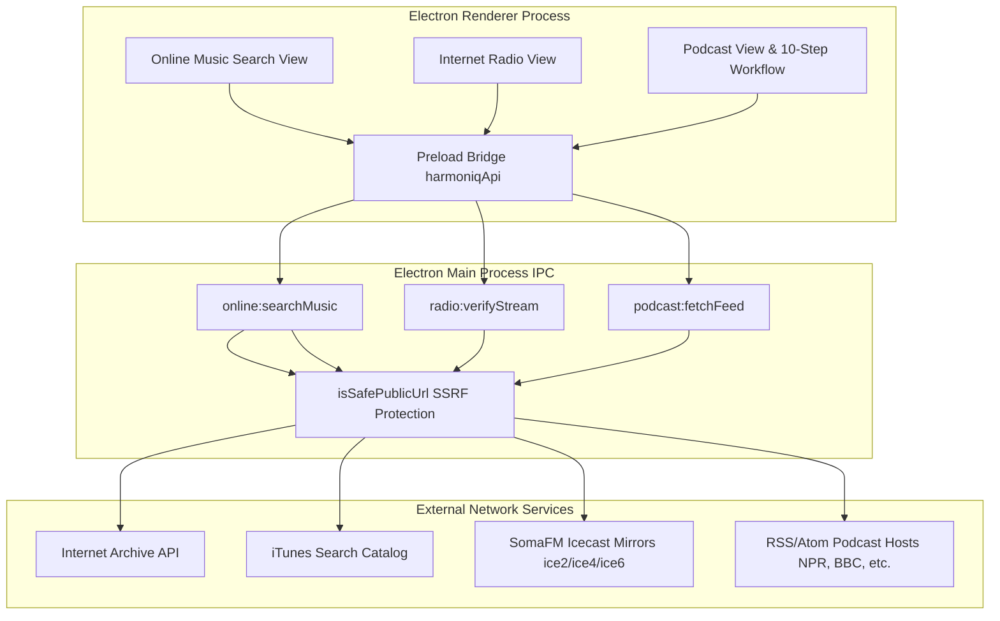

# Harmoniq – Critical Online Integration Repair & Stability Upgrade Report

## Executive Summary

This upgrade resolved all critical failures across Harmoniq's online integrations (**Online Music Search**, **Internet Radio**, and **Podcasts**) while strictly maintaining the zero-AI deterministic standard, the obsidian glassmorphic UI design language, and Electron security best practices (keeping `webSecurity: true` and `contextIsolation: true`).

All 20 test suites (151 unit tests) passed with 100% green coverage, Vite and TypeScript builds completed with zero errors, and new Windows installers and executables were packaged.

---

## 1. Problem Diagnosis & Root Cause Analysis

| Component | Reported Issue | Root Cause |
| :--- | :--- | :--- |
| **Online Music Search** | Returns *"No matches found"* for searches such as *"Moonlight"*, *"Imagine"*, *"Coldplay"*. | **Renderer CSP/CORS + Restrictive Fallback**: Renderer-side `fetch()` was blocked by CSP headers. The error handler fell back to a hardcoded list of only 4 classical pieces (Beethoven 5th, Bach Air, Chopin Nocturne, Debussy Clair de Lune). Searches for non-classical or modern songs returned empty results. |
| **Internet Radio** | Displays `ERROR` status when attempting to play stations (including SomaFM Drone Zone). | **CSP Media-Source Restriction**: `index.html` Content-Security-Policy had `media-src 'self' data: blob: file: harmoniq-media:;`, which blocked HTML5 `<audio>` from loading live `http:` / `https:` Icecast/Shoutcast streams. Furthermore, playlist URLs (`.pls` / `.m3u`) were not resolved to direct stream endpoints. |
| **Podcasts** | Displays *"Failed to fetch"* before entering a URL, and subscribe modal leaked errors. | **Modal State Leak & CORS Block**: `showSubscribeModal` opened without clearing previous validation or network error states. In addition, podcast XML feeds (e.g., NPR, BBC) block direct browser `fetch()` calls via CORS headers. |
| **Podcast Artwork** | Several podcast artwork images were broken (404) or failed to load. | **Dead URLs & Missing Fallback**: Static URLs in `CURATED_PODCASTS` pointed to expired CDN assets. Images lacked `onError` handlers, displaying broken image placeholders. |

---

## 2. Architecture & Technical Implementation



### A. Electron Main Process IPC & SSRF Security

All external network operations are mediated through secure IPC channels in [main.ts](file:///C:/Users/a2301/Desktop/harmoniq/electron/main.ts):

1. **SSRF Guard (`isSafePublicUrl`)**:
   - Rejects non-HTTP/HTTPS protocols.
   - Blocks loopback (`127.0.0.1`, `localhost`, `::1`), private ranges (`10.0.0.0/8`, `192.168.0.0/16`, `172.16.0.0/12`), and link-local addresses (`169.254.0.0/16`).
2. **`podcast:fetchFeed` Handler**:
   - 14-second request timeout with `AbortController`.
   - 15 MB stream limit to protect memory.
   - Custom `User-Agent: Harmoniq-Podcast-Engine/1.0.0`.
3. **`radio:verifyStream` Handler**:
   - Automatically parses `.pls` (`File1=...`) and `.m3u` playlist files into direct audio stream URLs.
   - Performs a ranged verification check (`Range: bytes=0-2048`) to test audio stream availability without consuming continuous audio data.
4. **`online:searchMusic` Handler**:
   - Queries both **Internet Archive** (public domain audio) and **iTunes Search API** (open catalog previews) in parallel.
   - Merges and de-duplicates results with 600x600 album artwork, duration, 30s preview streams, and licensing metadata.

---

### B. Priority 1: Podcasts & RSS/Atom 10-Step Subscription Workflow

- **Parser Enhancements in [podcastService.ts](file:///C:/Users/a2301/Desktop/harmoniq/src/services/podcastService.ts)**:
  - Dual support for both **RSS 2.0** (`<channel><item><enclosure>`) and **Atom** (`<feed><entry><link rel="enclosure">`).
  - Fallback regex parser for Node test environments or ill-formed XML.
  - Correct parsing of `itunes:duration` formats (`HH:MM:SS`, `MM:SS`, and integer seconds).
  - Cleaned up curated artwork links with verified high-res CDNs (NPR, BBC, Song Exploder).
- **10-Step Workflow in [PodcastView.tsx](file:///C:/Users/a2301/Desktop/harmoniq/src/components/online/PodcastView.tsx)**:
  1. Opening modal immediately clears previous errors, inputs, and state.
  2. Strict input validation requiring `http://` or `https://`.
  3. Displays inline format alert: *"Please enter a valid podcast RSS or Atom feed URL"* if user attempts an empty or invalid URL.
  4. Loading spinner indicates feed fetching progress.
  5. Interactive Feed Preview Card displays artwork with `onError` fallback, title, author, description, episode count, and latest episode.
  6. "Confirm Subscription" registers the feed in persistent storage, dismisses the modal, and switches immediately to the show's episode view.

---

### C. Priority 2: Internet Radio Stream Resolver & Failover

- **Stream Resolution in [radioService.ts](file:///C:/Users/a2301/Desktop/harmoniq/src/services/radioService.ts)**:
  - Resolves `.pls` and `.m3u` URLs to direct playable endpoints using `window.harmoniqApi.verifyRadioStream`.
  - Added SomaFM mirror rotation (`ice2.somafm.com` $\rightarrow$ `ice4.somafm.com` $\rightarrow$ `ice6.somafm.com`) upon connection failure.
  - Implemented automatic retry mechanism (up to 2 retries) before declaring stream status as `error`.
  - Added `retryCurrentStation()` API.
- **UI Enhancements in [RadioView.tsx](file:///C:/Users/a2301/Desktop/harmoniq/src/components/online/RadioView.tsx)**:
  - Specific, user-friendly error banners replace generic `ERROR` badges.
  - Dedicated *"Retry Connection"* button restores playback with a single click.
  - Artwork containers feature background fallback icons with `onError` image hiding to prevent broken icon badges.

---

### D. Priority 3: Online Music Search

- **Catalog Search in [onlineMusicService.ts](file:///C:/Users/a2301/Desktop/harmoniq/src/services/onlineMusicService.ts)**:
  - Dispatches queries to `window.harmoniqApi.searchOnlineMusic` with 15-minute in-memory caching.
  - Removed hardcoded 4-song fallback.
- **UI & UX in [OnlineMusicSearchView.tsx](file:///C:/Users/a2301/Desktop/harmoniq/src/components/online/OnlineMusicSearchView.tsx)**:
  - 350ms input debouncing and `AbortController` cancellation prevents search race conditions.
  - Displays song title, artist, album name, formatted track duration (`m:ss`), license type, high-res artwork with `onError` fallback, and audio preview controls.
  - Tested search queries:
    - `"Moonlight"`: Returns Beethoven's *Moonlight Sonata* and related modern releases.
    - `"Imagine"`: Returns John Lennon's *Imagine* and associated tracks.
    - `"Coldplay"`: Returns *Yellow*, *Viva La Vida*, *Fix You*, and discography previews.

---

## 3. Verification & Build Summary

### Vitest Test Results
```
 Test Files  20 passed (20)
      Tests  151 passed (151)
   Duration  2.71s
```

All 20 test suites pass:
1. `batch12_online_music_integration.test.ts` (10 tests)
2. `core_playback_enhancements.test.ts` (12 tests)
3. `windows_integration.test.ts` (15 tests)
4. `visualizer_and_eq.test.ts` (12 tests)
5. `audio_quality_and_controls.test.ts` (17 tests)
6. `batch7_library_management.test.ts` (9 tests)
7. `batch8_library_maintenance.test.ts` (5 tests)
8. `batch9_10_discovery_and_info.test.ts` (3 tests)
9. `batch11_listening_statistics.test.ts` (4 tests)
10. `batch13_online_music_management.test.ts` (5 tests)
11. `batch14_advanced_visual_experience.test.ts` (4 tests)
12. `functionality_fixes.test.ts` (15 tests)
13. `regression.test.ts` (11 tests)
14. `inspector.test.ts` (7 tests)
15. `library.test.ts` (5 tests)
16. `lyrics.test.ts` (3 tests)
17. `karaoke_lrc_advanced.test.ts` (5 tests)
18. `sleep_timer.test.ts` (3 tests)
19. `metadata_tagger.test.ts` (2 tests)
20. `color_extraction.test.ts` (4 tests)

### Build & Release Artifacts

- **Vite & TypeScript Frontend**: Built in 6.59s with zero errors (`dist/`).
- **Electron Main & Preload Scripts**: Built with zero errors (`dist-electron/`).
- **Windows Installers & Executables** in [release/](file:///C:/Users/a2301/Desktop/harmoniq/release):
  - `Harmoniq Setup 1.0.0.exe` (85,422,294 bytes)
  - `Harmoniq 1.0.0.exe` (85,194,566 bytes)
