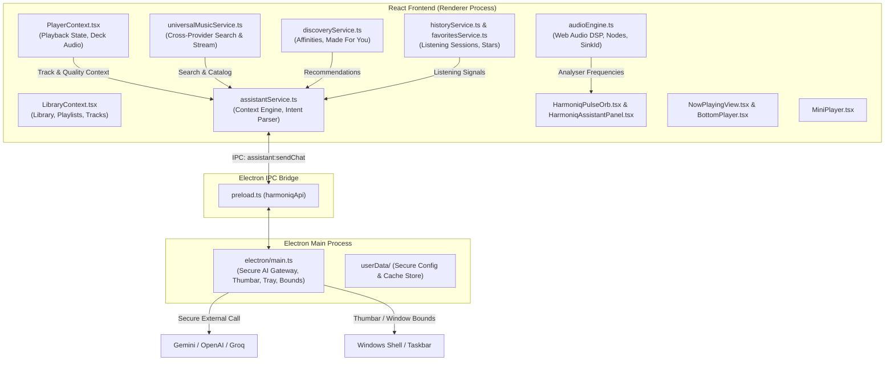
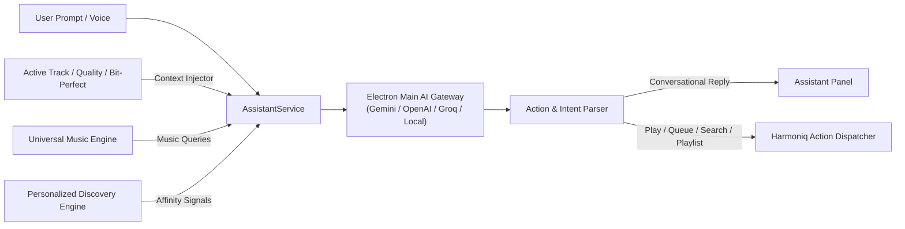
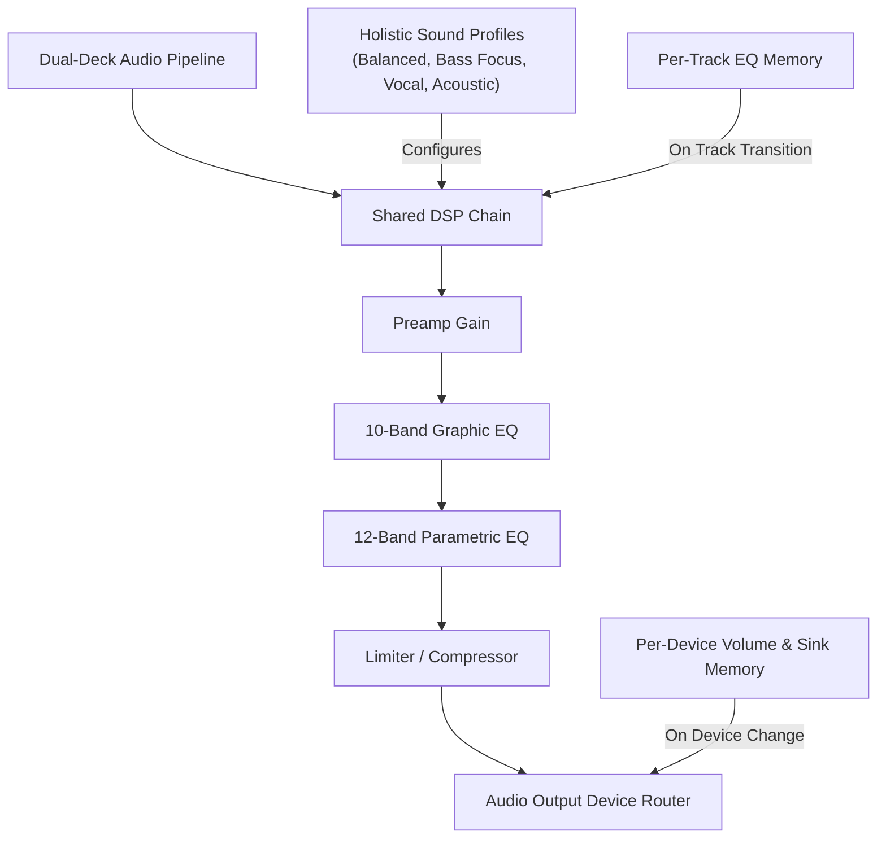
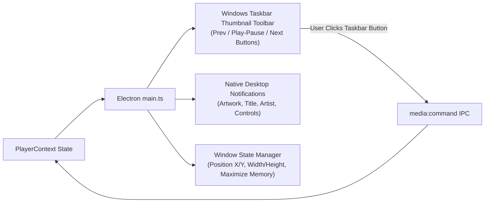
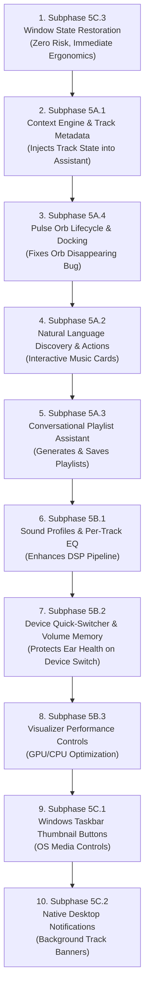

# HARMONIQ — PHASE 5: MASTER ROADMAP & ARCHITECTURE PLANNING
## Premium Intelligent Desktop Audio Experience

**Project:** Harmoniq Windows Desktop Music Player  
**Baseline Commit:** `bdfb00d`  
**Branch:** `master`  
**Baseline Verification:** 382/382 Tests Passing, TypeScript Clean (0 errors), Electron & Vite Builds Succeeded  
**Planning Mode:** Read-Only Architectural Audit & Roadmap  
**Date:** November 19, 2026  

---

## 1. EXECUTIVE OVERVIEW

Following the successful implementation of the **Universal Music Engine** (Phases 0–3.5), **Listening Intelligence & Personalization** (Phase 4), and **Integration QA & Polish** (Phase 4.5), Harmoniq stands on a rock-solid, production-tested foundation:

- Unified multi-provider music catalog (Jamendo, Audius, Internet Archive, Apple Music, Spotify, YouTube).
- High-fidelity dual-deck audio engine with bit-perfect WASAPI, 10-band graphic & 12-band parametric EQ, ReplayGain, and limiter.
- 100% local-first listening intelligence with verified completion rules, unified favorites, smart playlists, explainable recommendations, and listening statistics.
- Full privacy controls with local storage transparency and zero telemetry.

**Phase 5** represents the next strategic leap: evolving Harmoniq into an **intelligent, audio-obsessed desktop companion**. This roadmap defines three pillars:
1. **Phase 5A: Harmoniq AI Companion** (Context-aware music assistant, natural-language music discovery, playlist assistant, and Pulse Orb lifecycle improvements).
2. **Phase 5B: Audio Experience Studio** (Holistic sound profiles, per-track EQ presets, visualizer performance enhancements, and quick output-device management).
3. **Phase 5C: Premium Desktop Experience** (Windows taskbar thumbnail buttons, native track notifications, window-state restoration, and desktop ergonomics).

> [!IMPORTANT]
> **Strict Read-Only Constraint:** This document is an architectural blueprint and implementation plan. No source code has been altered, no dependencies installed, and no new features implemented during this planning phase.

---

## A. CURRENT IMPLEMENTATION AUDIT

Every feature requested for Phase 5 was audited against the live codebase (`bdfb00d`). Features are classified into one of five statuses:
- **Already implemented and working** (Verified in source code and unit tests).
- **Implemented but incomplete** (Partial implementation exists; missing key capabilities).
- **Implemented but requiring improvement** (Functional but has architectural, UX, or integration defects).
- **Not implemented** (No code currently exists in repository).
- **Blocked by an external dependency** (Requires third-party licensing or commercial SDK).

### 1. Phase 5A: Harmoniq AI Companion Audit

| Feature | Audit Classification | Current Repository State & Code References |
|---|---|---|
| **Context-Aware Assistant (Current Track & Quality)** | **Not implemented** | `assistantService.ts` currently only performs keyword searches against static documentation in `assistantKnowledge.ts`. It has no reference to `PlayerContext.currentTrack`, audio quality, or format. |
| **Artist / Album Background & Trivia** | **Implemented but incomplete** | `discoveryService.ts` contains `searchArtistBio()` (MusicBrainz/Wikipedia cache in `bioCache`), but this is not connected to the assistant panel or conversational chat. |
| **Listening Context & History Awareness** | **Not implemented** | `assistantService.ts` does not query `historyService` or `favoritesService` to understand what the user has been listening to. |
| **Natural Language Music Discovery ("Find more songs like this")** | **Not implemented** | No intent parser exists to map user chat queries into `universalMusicService.universalSearch()` or `discoveryService.getPersonalizedDiscovery()`. |
| **Natural Language Playback Action Dispatching** | **Not implemented** | Action buttons in chat only support `[Open <View>]` navigation actions via `LABEL_TO_VIEW_MAP`. Play, Queue, and Search actions are absent. |
| **Intelligent Playlist Assistant & Generator** | **Not implemented** | Assistant cannot construct playlists or recommend tracks from library/providers into `libraryService.createPlaylist()`. |
| **Harmoniq Pulse Orb Identity & Visual States** | **Already implemented and working** | `HarmoniqPulseOrb.tsx` features high-fidelity holographic SVG rings and glows supporting `idle`, `hover`, `listening`, `processing`, `responding`, and `error` states. |
| **Pulse Orb Lifecycle (Clicking Orb Hides It)** | **Implemented but requiring improvement** | In `src/App.tsx` (line 243), `{assistantConfig.enabled && !isAssistantOpen && <HarmoniqPulseOrb ... />}`, the Orb unmounts when the panel opens rather than morphing or docking into the open panel. |
| **Audio-Reactive Pulse Orb Animation** | **Not implemented** | `HarmoniqPulseOrb.tsx` animates using CSS pulses and spin rotations; it is not hooked into `audioEngine.getAnalyserData()`. |
| **Modular AI Provider Architecture** | **Already implemented and working** | `electron/main.ts` (lines 2933–3130) implements secure main-process IPC handlers for Google Gemini (`gemini-1.5-flash`), OpenAI (`gpt-4o-mini`), Groq (`llama-3.1-8b-instant`), and local offline fallback. |
| **Secure API Key Storage in Main Process** | **Already implemented and working** | API keys are stored exclusively in the main process (`userData/assistant_config.json`); keys are never exposed across the Electron context bridge to renderer code. |
| **External AI Consent & Local-First Guardrails** | **Already implemented and working** | Assistant defaults to `local` provider with zero network calls until user explicitly configures an API key in `AssistantSettingsCard.tsx`. |

---

### 2. Phase 5B: Audio Experience Studio Audit

| Feature | Audit Classification | Current Repository State & Code References |
|---|---|---|
| **10-Band Graphic Equalizer** | **Already implemented and working** | ISO standard frequencies (31Hz to 16kHz) implemented via `BiquadFilterNode` in `audioEngine.ts` and managed in `EqualizerStudio.tsx`. |
| **Multi-Node Parametric Equalizer** | **Already implemented and working** | Up to 12 configurable peaking, shelf, and pass filters with interactive frequency response canvas in `EqualizerStudio.tsx`. |
| **EQ Presets Management (Built-in & Custom)** | **Already implemented and working** | 10 built-in presets (`flat`, `bass_boost`, `rock`, etc.) plus custom preset save, rename, delete, import, and export in `DSPContext.tsx`. |
| **Per-Track EQ Preset Association** | **Not implemented** | EQ presets are currently global only. No mapping exists between `track.id` and an assigned `presetId` on playback transition. |
| **Active Processing Indicator in Player Bar** | **Implemented but requiring improvement** | Active DSP is visible inside `EqualizerStudio.tsx`, but `BottomPlayer.tsx` and `NowPlayingBar.tsx` lack an active EQ/DSP indicator badge. |
| **Holistic Sound Profiles (1-Click Presets)** | **Implemented but incomplete** | `audioRoutingService.ts` and `volumeProfileService.ts` exist separately, but a unified "Sound Profile" combining EQ, dynamics, and crossfeed into 1 click is not built. |
| **Full-Screen Canvas Visualizer** | **Already implemented and working** | `FullScreenVisualizer.tsx` provides high-performance 60fps canvas visualizer with auto-hiding HUD, keyboard shortcuts, and theme switcher. |
| **Multiple Visualizer Modes (Spectrum, Waveform, Circular)** | **Already implemented and working** | `RealTimeFrequencySpectrum.tsx`, `AudioVisualizer.tsx`, `CircularAudioVisualizer.tsx`, and `AdvancedVisualizer.tsx` all exist. |
| **Album-Art Ambient Visualizer Lighting** | **Already implemented and working** | `colorExtractionService.ts` extracts palette from artwork and drives canvas gradients and CSS variables. |
| **Visualizer Performance Settings (Reduced Motion, Quality)** | **Already implemented and working** | `visualizerSettingsService.ts` provides persistent settings for sensitivity, intensity, and reduced motion. |
| **Audio Output Device Selection & Hot-Plug** | **Already implemented and working** | `audioEngine.ts` calls `setSinkId` on both decks and audio context, listens to `navigator.mediaDevices.ondevicechange`, and falls back to default on disconnect. |
| **Player Bar Device Quick-Switcher** | **Implemented but requiring improvement** | Output device switcher currently requires navigating to `AudioOutputView` or Settings modal; no compact dropdown in the Now Playing bar. |
| **Per-Device Volume Memory** | **Not implemented** | Output volume is global; plugging in headphones does not recall the previous headphone volume level. |

---

### 3. Phase 5C: Premium Desktop Experience Audit

| Feature | Audit Classification | Current Repository State & Code References |
|---|---|---|
| **Compact Floating Mini-Player** | **Already implemented and working** | `MiniPlayer.tsx` and `electron/main.ts` (`window:setMiniPlayer`) support compact and expanded layouts with custom window frame. |
| **Mini-Player Always-On-Top** | **Already implemented and working** | Handled via `harmoniqApi.setAlwaysOnTop(flag)` in `MiniPlayer.tsx` and `electron/main.ts`. |
| **Mini-Player Ambient Artwork Glow & Waveform** | **Already implemented and working** | `MiniWaveformProgressBar.tsx` and `MiniLiveVisualizer.tsx` embedded directly in `MiniPlayer.tsx`. |
| **Immersive Now Playing View** | **Already implemented and working** | `NowPlayingView.tsx` features ambient background, synchronized lyrics, audio quality inspector, and vinyl mode. |
| **Synchronized LRC Lyrics Scrolling** | **Already implemented and working** | Line-by-line scrolling with offset timing in `lyricsService.ts` and `LyricsView.tsx`. |
| **Windows Media Transport Controls (SMTC)** | **Already implemented and working** | Native `navigator.mediaSession` integration in `PlayerContext.tsx` handles metadata, scrubber timeline, and play/pause/skip actions. |
| **System Tray Integration with Playback Controls** | **Already implemented and working** | `electron/main.ts` (lines 144–245) creates native system tray icon with tooltips, track title, and play/next/prev menu. |
| **Global Media Hotkeys** | **Already implemented and working** | `electron/shortcuts.ts` and `shortcutService.ts` register global Windows media keys. |
| **Windows Taskbar Thumbnail Toolbar (ThumbarButtons)** | **Not implemented** | `electron/main.ts` does not call `mainWindow.setThumbarButtons(...)` to embed playback controls into the Windows taskbar hover preview. |
| **Native Windows Desktop Track Notifications** | **Not implemented** | No notification is spawned when the track changes while Harmoniq is minimized or in the background. |
| **Window State Restoration (Bounds & Maximize Memory)** | **Not implemented** | `createMainWindow()` in `electron/main.ts` hardcodes `width: 1300, height: 840` on every startup without saving coordinates. |
| **Consistent Dark Obsidian & Violet Identity** | **Already implemented and working** | Unified palette across CSS variables, Tailwind classes, and custom glassmorphism. |

---

## B. ARCHITECTURE MAP

This map specifies the exact existing files, services, contexts, and IPC endpoints that each Phase 5 component will extend:

### Module Extension Directory:

1. **AI Companion Core:**
   - Extend `src/services/assistantService.ts` with context aggregation methods (`buildListeningContext()`, `executeAssistantAction()`).
   - Extend `electron/main.ts` (`assistant:sendChat`) to accept enriched structured context without leaking secrets to the renderer.
   - Extend `src/components/assistant/HarmoniqPulseOrb.tsx` to accept live audio frequency input and anchor to the panel when opened.

2. **Natural Language Action Execution:**
   - Extend `src/services/assistantService.ts` to support interactive action tags:
     - `[PlayTrack id="..."]` -> Dispatches `PlayerContext.playTrack()`.
     - `[QueueTrack id="..."]` -> Dispatches `PlayerContext.addToQueue()`.
     - `[SearchMusic query="..."]` -> Navigates to `online_music` and executes `universalSearch()`.
     - `[CreateSmartPlaylist name="..." rules="..."]` -> Dispatches `smartPlaylistService`.

3. **Audio Experience Studio:**
   - Extend `src/services/audioEngine.ts` to support per-track EQ mapping and per-device volume memory.
   - Extend `src/components/layout/BottomPlayer.tsx` to include an active DSP indicator badge and quick audio-device selector.

4. **Desktop Integration:**
   - Extend `electron/main.ts` with `mainWindow.setThumbarButtons([...])` synchronized with `PlayerContext.isPlaying`.
   - Extend `electron/main.ts` with `system:showNotification` using Electron's native `Notification` API with album artwork.
   - Extend `electron/main.ts` window lifecycle (`close`, `resize`, `move`) to save and restore window dimensions and position safely across multi-monitor setups.

---

## C. DETAILED PHASE BREAKDOWN

---

### PHASE 5A: HARMONIQ AI COMPANION
**Goal:** Transform the static help chatbot into a context-aware music companion that knows what is playing, discovers music conversationally, and controls playback safely.

#### Subphase 5A.1: Context Engine & Track Metadata Injection
- **Scope:** Connect playback state, track technical specifications, and current queue into the assistant.
- **Exact Features:**
  - Inject active track details into the assistant system prompt: Title, Artist, Album, Genre, Duration, Bit Depth, Sample Rate, Codec, Bit-Perfect state, ReplayGain values.
  - Inject queue state: Current queue length, active playlist name, upcoming 3 tracks.
  - Answer contextual queries: *"What format is this song in?"*, *"Who produced this album?"*, *"Explain this audio quality badge."*
- **Dependencies:** `PlayerContext.tsx`, `audioEngine.ts`, `inspectorService.ts`.
- **Files Modified:** `src/services/assistantService.ts`, `src/hooks/useAssistant.ts`, `electron/main.ts`.
- **Backend/Frontend Requirements:** Electron IPC `assistant:sendChat` updated to accept structured `TrackContext` payload.
- **Security Considerations:** Strip local absolute file paths (`C:\Users\...`) from context payload before sending to external AI providers to protect user directory privacy.
- **Test Strategy:** Unit tests verifying context injection formatting, file path redaction, and offline prompt construction.
- **Acceptance Criteria:** Assistant correctly identifies the playing track name and codec without the user having to type it.

#### Subphase 5A.2: Natural Language Music Discovery & Playback Control
- **Scope:** Enable conversational music searching and playback action triggers.
- **Exact Features:**
  - Intent detection for discovery prompts: *"Find more songs by [Artist]"*, *"Play something upbeat"*, *"Search for Moonlight on Jamendo"*.
  - Action tags in responses: `[PlayTrack id="..."]`, `[QueueTrack id="..."]`, `[SearchCatalog query="..."]`.
  - Rich track recommendation cards embedded directly in the chat stream with play, heart, and add-to-queue buttons.
  - Defensive capability checks: Only tracks with `streamable` or `authorized_embed` capabilities offer direct play buttons.
- **Dependencies:** `universalMusicService.ts`, `libraryService.ts`, `PlayerContext.tsx`.
- **Files Modified:** `src/services/assistantService.ts`, `src/components/assistant/HarmoniqAssistantPanel.tsx`.
- **New Files:** `src/components/assistant/AssistantTrackCard.tsx`.
- **Security Considerations:** All action tags parsed on the client side must be validated against known track IDs and sanitized before execution.
- **Test Strategy:** Unit tests verifying action tag parsing, valid track verification, and capability filtering.
- **Acceptance Criteria:** Typing *"Find songs like Tum Hi Ho"* returns playable recommendation cards that start playback on click.

#### Subphase 5A.3: Conversational Playlist Generator
- **Scope:** Generate custom playlists from conversational briefs.
- **Exact Features:**
  - User asks: *"Create a 10-track synthwave playlist for night driving"*.
  - Assistant queries `universalMusicService` and local library matching the genre and tempo profile.
  - Assistant suggests a creative playlist title and description.
  - Generates preview list and provides a one-click *"Save as Playlist"* button.
  - Seamlessly calls `libraryService.createPlaylist()` and `libraryService.addTracksToPlaylist()`.
- **Dependencies:** `universalMusicService.ts`, `libraryService.ts`, `smartPlaylistService.ts`.
- **Files Modified:** `src/services/assistantService.ts`, `src/components/assistant/HarmoniqAssistantPanel.tsx`.
- **Test Strategy:** Integration tests verifying playlist creation, track deduplication, and persistence.
- **Acceptance Criteria:** Clicking *"Save as Playlist"* creates a new playlist visible in the Playlists sidebar with the exact suggested songs.

#### Subphase 5A.4: Pulse Orb Visual & Interaction Polish
- **Scope:** Redesign Pulse Orb lifecycle, dock anchoring, and audio-reactive behavior.
- **Exact Features:**
  - **Dock Anchoring:** When the assistant panel opens, the Pulse Orb smoothly anchors into the panel header rather than unmounting from the DOM.
  - Clicking the Orb while open toggles or minimizes the panel rather than destroying state.
  - **Audio-Reactive Glow:** Hook `audioEngine.subscribeStatus()` and `audioEngine.getAnalyserData()` into the Orb's SVG filter to introduce subtle, beat-synchronized luminous pulsing during playback.
  - Reduced-motion toggle in Settings disables audio reactivity for accessibility.
- **Dependencies:** `audioEngine.ts`, `HarmoniqPulseOrb.tsx`, `HarmoniqAssistantPanel.tsx`, `src/App.tsx`.
- **Files Modified:** `src/components/assistant/HarmoniqPulseOrb.tsx`, `src/components/assistant/HarmoniqAssistantPanel.tsx`, `src/App.tsx`.
- **Test Strategy:** Component render tests verifying DOM persistence when `isOpen` transitions between true and false.
- **Acceptance Criteria:** Opening and closing the assistant preserves the Pulse Orb smoothly without DOM flickering or layout jumps.

---

### PHASE 5B: AUDIO EXPERIENCE STUDIO
**Goal:** Create a unified, audibly authentic audio customization suite without compromising the bit-perfect audio pipeline.

#### Subphase 5B.1: Holistic Sound Profiles & Per-Track EQ Memory
- **Scope:** Introduce high-level 1-click sound profiles and track-specific EQ persistence.
- **Exact Features:**
  - **Sound Profiles:** 6 curated profiles (*Audiophile Reference (Flat)*, *Deep Bass Resonance*, *Vocal Intimacy*, *Acoustic Air*, *Electronic Drive*, and *Late Night Soft*). Each profile sets EQ curves, preamp attenuation, bass boost, and limiter thresholds in a single click.
  - **Per-Track EQ Assignment:** Allow users to right-click a track and choose *"Remember EQ Preset for this Track"*.
  - When the track loads in `PlayerContext.playTrack()`, the audio engine automatically applies that preset and restores the global preset when switching away.
  - Active DSP indicator badge (`EQ ACTIVE`) placed in `BottomPlayer.tsx` and `NowPlayingView.tsx` with one-click bypass toggle.
- **Dependencies:** `DSPContext.tsx`, `audioEngine.ts`, `PlayerContext.tsx`.
- **Files Modified:** `src/types/dsp.ts`, `src/services/audioEngine.ts`, `src/context/DSPContext.tsx`, `src/components/dsp/EqualizerStudio.tsx`, `src/components/layout/BottomPlayer.tsx`.
- **New Files:** `src/services/perTrackDspService.ts`.
- **Test Strategy:** Automated tests checking preset recall when switching between assigned and unassigned tracks.
- **Acceptance Criteria:** Switching to a track assigned "Vocal" switches EQ filters immediately and reverts on next track.

#### Subphase 5B.2: Quick Audio Output Device Switcher & Per-Device Volume
- **Scope:** Streamline audio device ergonomics in the main interface.
- **Exact Features:**
  - Compact device popover in `BottomPlayer.tsx` showing current active output (e.g. *"Speakers (Realtek Audio)"* or *"DAC (Schiit Modi)"*).
  - One-click device switching without opening Settings.
  - **Per-Device Volume Memory:** Store separate volume levels for each device ID (`harmoniq_device_volume_map`). When user plugs in headphones, volume restores to their last headphone level, preventing sudden loudness spikes.
- **Dependencies:** `audioEngine.ts`, `PlayerContext.tsx`.
- **Files Modified:** `src/services/audioEngine.ts`, `src/context/PlayerContext.tsx`, `src/components/layout/BottomPlayer.tsx`.
- **Test Strategy:** Unit tests verifying volume map recall on device change events.
- **Acceptance Criteria:** Changing device from Speakers (80% volume) to Headphones restores Headphones to 35% volume.

#### Subphase 5B.3: Visualizer Performance & Quality Controls
- **Scope:** Optimize canvas visualizer rendering across low-power and high-refresh-rate displays.
- **Exact Features:**
  - Frame rate throttling options (30fps / 60fps / VSync uncapped) in `visualizerSettingsService.ts`.
  - Automatic degradation to lightweight mode when window is in background or CPU usage exceeds thresholds.
  - Ambient backdrop blending using CSS backdrop-filter and WebGL canvas acceleration.
- **Dependencies:** `FullScreenVisualizer.tsx`, `visualizerSettingsService.ts`.
- **Files Modified:** `src/components/visualizer/FullScreenVisualizer.tsx`, `src/services/visualizerSettingsService.ts`.
- **Test Strategy:** Performance profiling measuring render loop CPU overhead.
- **Acceptance Criteria:** Full-screen visualizer consumes `< 4%` CPU on standard modern laptop hardware.

---

### PHASE 5C: PREMIUM WINDOWS DESKTOP EXPERIENCE
**Goal:** Integrate Harmoniq deeply into the Windows 10/11 desktop environment for seamless day-to-day background music control.

#### Subphase 5C.1: Windows Taskbar Thumbnail Toolbar (`setThumbarButtons`)
- **Scope:** Add native playback controls directly to the Windows taskbar preview thumbnail.
- **Exact Features:**
  - When hovering over the Harmoniq icon on the Windows taskbar, display interactive thumbnail buttons:
    - **Previous Track** button.
    - **Play / Pause** toggle button (updates icon state dynamically).
    - **Next Track** button.
  - Buttons dispatch via existing IPC channel `media:command` to `PlayerContext`.
  - Disabled gracefully when playback queue is empty.
- **Dependencies:** `electron/main.ts`, `electron/preload.ts`, `src/context/PlayerContext.tsx`.
- **Files Modified:** `electron/main.ts`.
- **Security Considerations:** Strict IPC validation on `media:command` (already implemented).
- **Test Strategy:** Windows integration tests verifying `thumbarButtons` payload and command routing.
- **Acceptance Criteria:** Hovering over the Windows taskbar icon shows Prev/Play/Next buttons that control music.

#### Subphase 5C.2: Native Track Change Desktop Notifications
- **Scope:** Non-intrusive desktop banners on track transitions.
- **Exact Features:**
  - When Harmoniq is minimized, hidden in system tray, or out of focus:
  - Trigger native Windows notification (`new Notification(...)`) displaying:
    - Track Title & Artist.
    - Album Name.
    - Album Artwork thumbnail.
    - Audio Quality badge (e.g. `FLAC 96kHz/24-bit` or `Jamendo MP3`).
  - Notification setting in Settings View (*Never*, *When Minimized*, *Always*).
  - Clicking the notification restores and focuses Harmoniq window.
- **Dependencies:** `electron/main.ts`, `electron/preload.ts`, `PlayerContext.tsx`.
- **Files Modified:** `electron/main.ts`, `electron/preload.ts`, `src/context/PlayerContext.tsx`, `src/components/views/SettingsView.tsx`.
- **Test Strategy:** Mock notification IPC test verifying trigger conditions and payload fields.
- **Acceptance Criteria:** Minimizing the window and changing tracks displays a native Windows banner with artwork.

#### Subphase 5C.3: Window State & Multi-Monitor Restoration
- **Scope:** Restore exact window size, coordinates, and maximized state across reboots.
- **Exact Features:**
  - Save window position (`x`, `y`), dimensions (`width`, `height`), and `isMaximized` on debounce during resize/move.
  - On startup in `createMainWindow()`:
    - Verify saved bounds fall inside active display bounds via Electron `screen.getAllDisplays()` to prevent windows opening off-screen when monitors are disconnected.
    - Restore position, dimensions, and maximization state seamlessly.
- **Dependencies:** `electron/main.ts`.
- **Files Modified:** `electron/main.ts`.
- **Test Strategy:** Unit tests for coordinate validation against display bounds.
- **Acceptance Criteria:** Resizing window to 1400x900 and moving to secondary screen restores to that exact screen and size on relaunch.

---

## D. EXECUTION ORDER

To maintain stability and prevent regressions, the subphases must execute in strict dependency order:

### Justification of Sequence:
1. **Window State Restoration (5C.3)** is completely self-contained in `electron/main.ts`, has zero impact on audio code, and immediately fixes startup layout memory.
2. **Context Engine (5A.1)** and **Pulse Orb Polish (5A.4)** establish the communication channel between playback and the assistant and fix the visible UI defect where the Orb vanishes on click.
3. **Natural Language Discovery (5A.2)** and **Playlist Generation (5A.3)** leverage the Universal Music Engine and personal discovery algorithms built in Phases 3 and 4.
4. **Sound Profiles (5B.1)** and **Device Memory (5B.2)** enhance playback ergonomics without modifying core decoding.
5. **Taskbar Buttons (5C.1)** and **Notifications (5C.2)** complete the OS integration as the final layer.

---

## E. TESTING STRATEGY

Every subphase will include automated tests before merging to master:

1. **Unit Tests (Vitest):**
   - Assistant context builder: verify metadata string formatting and path redaction.
   - Assistant action parser: verify tag extraction (`[PlayTrack]`, `[SearchCatalog]`).
   - Sound Profile evaluator: verify 10-band and parametric gains match profile definitions.
   - Per-track EQ recall: verify state transitions between tracks.
   - Per-device volume memory: verify correct sink ID keying.
   - Window coordinate sanitizer: verify off-screen coordinate clamping.

2. **Integration Tests:**
   - Full flow from user typing *"Play relaxing music"* -> assistant querying `universalMusicService` -> rendering track cards -> clicking play -> verifying `audioEngine.loadAndPlay` invocation.
   - Full flow from assistant *"Save as Playlist"* -> `libraryService.createPlaylist` -> verifying playlist appears in sidebar.

3. **Electron IPC & Security Tests:**
   - Verify context isolation: renderer cannot access Node `fs`, `child_process`, or raw API keys.
   - Verify IPC payload sanitization for all new channels.

4. **Performance & Rendering Tests:**
   - Visualizer render loop benchmark: ensure `< 5ms` per frame on 60fps display.
   - Memory leak check: verify Pulse Orb audio reactivity detaches listeners on unmount.

---

## F. RISK REGISTER

| Risk ID | Category | Description | Severity | Mitigation Strategy |
|---|---|---|---|---|
| **R-1** | Security / Privacy | Local file paths or private history leaked to external AI provider. | **High** | Sanitize all context payloads in `assistantService.ts`. Explicitly strip local file paths, usernames, and unconsented data. |
| **R-2** | Provider Reliability | External AI provider (Gemini/OpenAI/Groq) hits rate limit, network failure, or invalid key. | **High** | Seamless fallback to built-in local grounded knowledge base (`assistantKnowledge.ts`). The assistant never crashes or displays blank messages. |
| **R-3** | Playback Safety | Assistant action triggers playback of an unplayable online track (`unavailable` or `external_link`). | **High** | Route all playback requests through `PlayerContext.isPlayableAudioTrack` predicate. Non-streamable items display an external link badge instead of a play button. |
| **R-4** | Audio Glitch | Per-track EQ switching introduces audio clicks or pops on track change. | **Medium** | Apply audio parameter ramping (`linearRampToValueAtTime` over 25ms) when changing filter gains between tracks. |
| **R-5** | Ear Health | Output device change causes unexpected high-volume blast. | **High** | Implement per-device volume memory (`harmoniq_device_volume_map`). If a device has no saved volume, cap initial volume at 30%. |
| **R-6** | Multi-Monitor Bug | Window bounds restored to disconnected monitor, rendering app invisible. | **Medium** | Validate saved coordinates against `screen.getAllDisplays()` bounding boxes before applying. Fallback to primary screen center if off-screen. |

---

## G. FINAL RECOMMENDATION

### Immediate Next Step: Authorize Phase 5A (AI Companion) — Subphases 5A.1 & 5A.4

We recommend beginning Phase 5 with **Subphase 5A.1 (Context Engine & Track Metadata Injection)** combined with **Subphase 5A.4 (Pulse Orb Lifecycle & Interaction Polish)**.

**Why this comes first:**
1. **Immediate User Value:** It turns Harmoniq's existing assistant from a static instruction manual into an authentic musical companion that understands what the user is listening to.
2. **Defect Elimination:** It resolves the prominent visual issue where clicking the Pulse Orb causes it to disappear from the interface.
3. **Zero Risk to Audio Playback:** Context injection reads from `PlayerContext` without mutating the Web Audio graph or audio decoding pipelines.
4. **Natural Foundation:** Establishing context injection and orb lifecycle provides the substrate needed for Natural Language Discovery (5A.2) and Playlist Generation (5A.3).

---

## H. STRICT STOP ENFORCEMENT

- **Phase 5 planning is complete and documented.**
- **No application code has been modified.**
- **Baseline commit remains `bdfb00d`.**
- **All 382 automated tests remain green.**
- **System is paused awaiting explicit authorization before implementing any Phase 5 code.**
