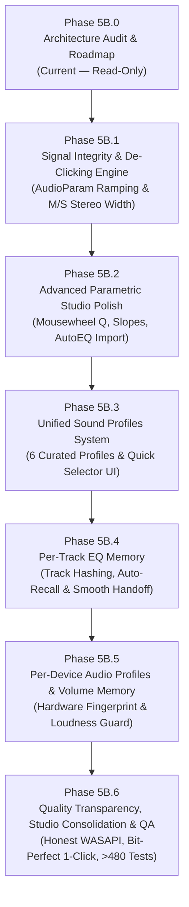

# HARMONIQ 2.0 — PHASE 5B: AUDIO EXPERIENCE STUDIO & PROFESSIONAL DSP TRANSFORMATION
## PHASE 5B.0 — READ-ONLY ARCHITECTURE AUDIT & MASTER ROADMAP

**Baseline Commit:** `0b01ba2`  
**Branch:** `master`  
**Checkpoint:** `checkpoint-phase5a5-complete`  
**Execution Mode:** Read-Only Architectural Audit & Phased Implementation Roadmap  
**Status:** COMPLETE & READY FOR APPROVAL  

---

## 1. EXECUTIVE SUMMARY

Harmoniq's audio architecture has evolved across Phases 0 through 5A into a dual-deck playback system built on the Web Audio API and Chromium's underlying Windows audio subsystem. With Phase 5A complete (context-aware AI assistant, conversational music discovery, smart playlist creation, and audio-reactive Pulse Orb), Phase 5B focuses on **audio fidelity, sound personalization, and professional DSP capabilities**.

### Current Baseline Health
- **Git HEAD:** `0b01ba2` (`feat(assistant): add audio-reactive Pulse Orb visualization`)
- **Working Tree:** Clean (zero unstaged changes)
- **Active Tests:** 462 passing across 31 test suites
- **Build Status:** TypeScript compiler (`tsc --noEmit`), Vite build, and Electron compilation clean and passing.

### Core Strengths of the Existing Audio Engine
1. **Dual-Deck Web Audio Architecture:** Real-time dual-deck playback (`deckA` and `deckB`) enabling zero-gap transitions (60ms pre-load handoff) and smooth equal-power crossfades (1–12 seconds).
2. **Cascaded 32-Bit Floating Point DSP:** Complete signal chain featuring a 10-band graphic equalizer (ISO standard frequencies), up to 12 cascaded parametric biquad filter nodes, low-shelf bass boost (100 Hz), high-shelf treble control (10 kHz), 2x2 channel matrix, and a brickwall lookahead anti-clipping limiter.
3. **True Frequency Response Calculation:** Real-time composite frequency response curves evaluated directly from physical `BiquadFilterNode` transfer functions via `getCombinedFrequencyResponse()` using `biquad.getFrequencyResponse()`.
4. **ReplayGain & Peak Guard:** Standardized track and album gain normalization with a -0.1 dBFS brickwall peak prevention ceiling.
5. **Quality Tier Diagnostics:** Stream analysis via `music-metadata` reporting real codec, sample rate, bit depth, container format, and bitrate.

### Technical Realities & Platform Boundaries on Windows Desktop
A primary objective of this audit is distinguishing between genuine hardware capabilities and mock or cosmetic representations:
- **WASAPI Shared Mode vs. Exclusive Mode:** In Electron/Chromium, audio output is routed via `AudioContext.setSinkId()` and `HTMLMediaElement.setSinkId()`. This pipeline communicates with the Windows Audio Session API (WASAPI) strictly in **Shared Mode** (System Mixer). Entries in `electron/main.ts` labeled `wasapi_exclusive` are diagnostic mock structures; Chromium does not expose direct WASAPI Exclusive Mode or ASIO hardware locking without native C++ Node addons.
- **System Resampling:** Whenever the source audio sample rate (e.g., 44.1 kHz, 96 kHz, 192 kHz) does not match the Windows system mixer rate (typically 48.0 kHz), the Windows Audio Engine resamples the stream. The existing `inspectorService.ts` accurately diagnoses and reports this condition.
- **Bit-Perfect Playback Reality:** Bit-perfect transport requires: (1) lossless audio source, (2) sample rate match between source and hardware, (3) 100% digital volume (0 dB unity gain), (4) DSP bypass or completely flat filter response, (5) ReplayGain disabled, and (6) direct unmixed DAC hardware transport. In Harmoniq's current architecture, condition (6) is subject to the Windows Audio Engine shared mixer. The UI must disclose this honestly rather than displaying artificial "Exclusive Mode" status.

---

## 2. CURRENT AUDIO ARCHITECTURE DEEP DIVE

### 2.1 The Dual-Deck Playback Pipeline
Harmoniq implements a dual-deck architecture inside `src/services/audioEngine.ts`:
- **Deck A & Deck B:** Each deck consists of an HTML5 `<audio>` element wrapped into a Web Audio `MediaElementAudioSourceNode`.
- **Fader Gains:** Each deck passes through its own `faderGain` (used for volume and crossfading) and a dedicated `replayGain` node.
- **Master Mix Gain:** Both decks sum into `masterMixGain`, which feeds either the active DSP path or the DSP bypass path.

```text
                  [ Deck A: HTMLAudioElement ]           [ Deck B: HTMLAudioElement ]
                               │                                      │
                               ▼                                      ▼
                  [ MediaElementAudioSourceNode ]        [ MediaElementAudioSourceNode ]
                               │                                      │
                               ▼                                      ▼
                        [ faderGain A ]                        [ faderGain B ]
                               │                                      │
                               ▼                                      ▼
                      [ replayGainNode A ]                   [ replayGainNode B ]
                               │                                      │
                               └──────────────────┬───────────────────┘
                                                  ▼
                                          [ masterMixGain ]
                                                  │
                 ┌────────────────────────────────┴───────────────────────────────┐
                 │                                                                │
                 ▼ (DSP Active: dspSettings.enabled = true)                       ▼ (DSP Bypassed)
        [ preampGainNode ]                                                 [ dspBypassGain ]
                 │                                                                │
                 ▼                                                                │
    [ 10-Band Graphic EQ Biquads ]                                                │
    (31Hz, 62Hz, 125Hz, 250Hz, 500Hz, 1kHz, 2kHz, 4kHz, 8kHz, 16kHz)            │
                 │                                                                │
                 ▼                                                                │
    [ 12-Band Parametric EQ Biquads ]                                             │
    (Configurable: peaking, lowshelf, highshelf, lowpass, highpass)               │
                 │                                                                │
                 ▼                                                                │
        [ bassBoostFilter ] (Lowshelf @ 100 Hz, 0 to +12 dB)                      │
                 │                                                                │
                 ▼                                                                │
         [ trebleFilter ] (Highshelf @ 10 kHz, -6 to +12 dB)                      │
                 │                                                                │
                 ▼                                                                │
    [ 2x2 Channel Matrix Nodes ]                                                  │
    (Splitter -> gainLL, gainLR, gainRL, gainRR -> Merger)                        │
                 │                                                                │
                 ▼                                                                │
        [ limiterNode ] (DynamicsCompressor: -0.5dBFS, 20:1, 3ms attack)          │
                 │                                                                │
                 ▼                                                                │
         [ dspActiveGain ]                                                        │
                 │                                                                │
                 └────────────────────────────────┬───────────────────────────────┘
                                                  ▼
                                          [ analyserNode ] (2048 FFT)
                                                  │
                                                  ▼
                                        [ audioCtx.destination ]
```

### 2.2 Equalizer Infrastructure & Mutual Exclusivity
- **Graphic EQ:** 10 peaking filters with fixed ISO center frequencies (`[31, 62, 125, 250, 500, 1000, 2000, 4000, 8000, 16000]`), gain range -12 dB to +12 dB, and fixed Q = 1.414.
- **Parametric EQ:** Up to 12 dynamic biquad filters supporting `'peaking' | 'lowshelf' | 'highshelf' | 'lowpass' | 'highpass' | 'bandpass' | 'notch' | 'allpass'`. Frequency range: 20 Hz – 20,000 Hz, gain range: -18 dB to +18 dB, Q range: 0.1 to 18.0.
- **Operating Modes:** In `audioEngine.applyDSPSettings()`, Graphic and Parametric modes are strictly mutually exclusive. When `eqMode === 'graphic'`, all 12 parametric filter gains are flattened to 0 dB. When `eqMode === 'parametric'`, all 10 graphic filter gains are flattened to 0 dB.
- **Tone Shelves:** Dedicated `bassBoostFilter` (100 Hz shelf) and `trebleFilter` (10 kHz shelf) sit in series after the equalizers, allowing macro tone adjustments without altering individual EQ sliders or filter points.

### 2.3 Dynamics & Anti-Clipping Limiter
- **Limiter Topology:** Configured using a Web Audio `DynamicsCompressorNode` positioned as the final stage before `dspActiveGain`.
- **Parameters:** Threshold: -0.5 dBFS, Knee: 0.0 dB (hard knee), Ratio: 20:1 (brickwall limiting), Attack: 0.003s (3ms lookahead), Release: 0.050s (50ms recovery).
- **Gain Reduction Metering:** Polled at 15 Hz in `DSPContext.tsx` via `audioEngine.getLimiterMetrics()`, providing real-time dB reduction to visual meters in the UI.

### 2.4 Channel Matrix & Spatial Manipulation
- **Topology:** Web Audio `ChannelSplitterNode(2)` -> 4 independent `GainNode` instances (`gainLL`, `gainLR`, `gainRL`, `gainRR`) -> `ChannelMergerNode(2)`.
- **Modes Supported:**
  - `stereo`: Direct pass-through (`LL=1, LR=0, RL=0, RR=1`).
  - `mono`: 3 dB attenuation sum (`LL=0.707, LR=0.707, RL=0.707, RR=0.707`).
  - `left_only`: Left channel duplicated to both ears (`LL=1, LR=1, RL=0, RR=0`).
  - `right_only`: Right channel duplicated to both ears (`LL=0, LR=0, RL=1, RR=1`).
  - `balance`: Linear panning attenuation between -1.0 (hard left) and +1.0 (hard right).

### 2.5 Output Device Routing & Persistence
- Output routing is managed via `audioRoutingService.ts` and `audioEngine.setOutputDevice(sinkId)`.
- Uses standard W3C `setSinkId` on the `AudioContext` and underlying HTMLMediaElements.
- Profiles are persisted in `localStorage` under `harmoniq_audio_routing_profiles_v1`.
- Automatic device disconnect recovery: Listens to `navigator.mediaDevices.ondevicechange`, detects if active device vanished, and gracefully redirects audio to `profile.fallbackDeviceId || 'default'`.

---

## 3. FEATURE-BY-FEATURE CAPABILITY AUDIT

| Feature | Current Implementation Status | Code Location | Missing / Needs Rework | Feasibility & Risk |
|---|---|---|---|---|
| **Feature A: Per-Track EQ Memory** | **Missing** (0%) | None | Track hash/ID persistence service, auto-recall on track change, smooth parameter ramping, UI indicators | High Feasibility / Low Risk |
| **Feature B: Per-Device Audio Profiles** | **Partially Implemented** (40%) | `audioRoutingService.ts` | Storing & applying DSP presets per device, per-device volume memory, hardware fingerprinting | High Feasibility / Low Risk |
| **Feature C: One-Click Sound Profiles** | **Partially Implemented** (50%) | `DSPContext.tsx`, `types/dsp.ts` | Unified SoundProfile model (EQ + Preamp + Tone + Matrix + Limiter), curated studio presets, dedicated UI selector | High Feasibility / Low Risk |
| **Feature D: Advanced Parametric EQ Studio** | **Partially Implemented** (75%) | `EqualizerStudio.tsx`, `audioEngine.ts` | Mousewheel Q scaling, band solo/audition, slope selection (12/24 dB/oct), AutoEQ / Equalizer APO preset import | High Feasibility / Low-Med Risk |
| **Feature E: Audio Device Manager & Output Engine** | **Partially Implemented** (60%) | `AudioDeviceManager.tsx`, `AudioOutputView.tsx` | Honest WASAPI shared/exclusive disclosure, per-device volume map, buffer latency tuning synchronization | High Feasibility / Low Risk |
| **Feature F: Advanced DSP Controls** | **Fully Implemented in Engine / Partially in UI** (85%) | `audioEngine.ts`, `EqualizerStudio.tsx` | Parameter ramping (de-clicking), stereo width expansion in 2x2 matrix, quick DSP control bar in Player UI | High Feasibility / Low Risk |
| **Feature G: Audio Quality Transparency & Bit-Perfect Engine** | **Partially Implemented** (70%) | `inspectorService.ts`, `AudioQualityInspector.tsx` | Remove misleading WASAPI Exclusive mock status, explain Windows shared resampling honestly, 1-click "Bit-Perfect Mode" toggle | High Feasibility / Low Risk |
| **Feature H: Smart Listening Profiles** | **Missing / Foundation Exists** (20%) | `types/audioRouting.ts` (`ListeningRoom`) | Automatic profile triggering on device change, AI-assisted sound signature suggestions | High Feasibility / Med Risk |

---

### Detailed Analysis of Target Features

#### Feature A: Per-Track EQ Memory
- **Current State:** Missing. Harmoniq applies a single global DSP configuration across all tracks. If a user sets an EQ curve for an acoustic track, it persists into subsequent bass-heavy electronic tracks unless manually changed.
- **What Already Exists:** `audioEngine.applyDSPSettings()` can dynamically update filter gains in real time. Track metadata (including unique ID, file path, and title/artist) is available in `PlayerContext.currentTrack`.
- **What Is Missing:**
  1. `TrackEQMemoryService`: A dedicated service managing an indexed map of `trackIdentifier -> { presetId?: string, customSettings?: DSPSettings }`.
  2. Track Fingerprinting: A robust identifier using track ID or sanitized file path/hash.
  3. Player Integration: Hook in `PlayerContext.playTrack()` that looks up the track in `TrackEQMemoryService`. If an assignment exists, it saves the current global preset as a "return fallback" and activates the track's preset. When an unassigned track plays, it restores the fallback.
  4. Smooth Handoff: Parameter ramping (20–40ms `setTargetAtTime`) to avoid audible clicks or pops during track transitions.
  5. UI Surface: Context menu item on tracks (*"Remember EQ for this track"*), an active indicator badge in `BottomPlayer.tsx` (*"Track EQ Active"*), and an option to clear track assignments.
- **Feasibility & Risk:** High feasibility, Low risk.

#### Feature B: Per-Device Audio Profiles
- **Current State:** Partially Implemented. `audioRoutingService.ts` defines `AudioRoutingProfile` with preferred device IDs and `ListeningRoom` models. However, selecting a profile only changes the audio output device; it does **not** store or trigger DSP settings, nor does it remember per-device volume.
- **What Already Exists:** Output device enumeration, fallback on disconnect, and device change listeners.
- **What Is Missing:**
  1. Profile-DSP Association: Extending `AudioRoutingProfile` to include `dspPresetId` or `soundProfileId`.
  2. Per-Device Volume Memory: Storing individual volume levels per device ID (e.g. `harmoniq_device_volume_map_v1`). Prevents sudden dangerous volume blasts when switching from low-sensitivity speakers to high-sensitivity in-ear monitors.
  3. Device Fingerprinting: Handling Windows USB device reconnects where device IDs can change between reboots by matching `label` and `groupId`.
- **Feasibility & Risk:** High feasibility, Low risk.

#### Feature C: One-Click Sound Profiles
- **Current State:** Partially Implemented. `BUILT_IN_PRESETS` in `types/dsp.ts` contains 18 presets, but they only modify EQ bands, preamp, bass boost, and treble.
- **What Already Exists:** Preset application and custom preset storage in `DSPContext.tsx`.
- **What Is Missing:**
  1. Unified Sound Profile Architecture: Moving beyond simple EQ presets to comprehensive acoustic signatures that combine:
     - EQ Mode & Curve (Graphic or Parametric)
     - Preamp Attenuation
     - Bass Boost & Treble Shelves
     - Stereo Width / Spatial Enhancer (Mid-Side matrix balance)
     - Anti-Clipping Limiter Threshold & Knee
     - Target Loudness Offset
  2. Curated Studio Sound Profiles:
     - *Audiophile Reference:* 100% flat, zero boost, unity gain, maximum transparency.
     - *Late Night Intimacy:* Gentle high/low rolloff, compressed dynamics, subdued bass for quiet night listening.
     - *Deep Bass Resonance:* Sub-bass lift (40–80 Hz), 100 Hz shelf boost, moderate preamp cut to prevent clipping.
     - *Acoustic Air:* High-frequency airiness (8 kHz–16 kHz lift), tight low-end, expanded stereo width.
     - *Vocal Clarity:* 1 kHz–3 kHz midrange prominence, subtle low-cut (sub-80 Hz attenuation) to clear muddy vocals.
     - *Club Electronic:* V-shaped curve, aggressive punch, lookahead limiter engaged.
  3. UI Presentation: Prominent 1-click sound profile carousel/grid in `EqualizerStudio.tsx` and quick selector in `BottomPlayer.tsx`.
- **Feasibility & Risk:** High feasibility, Low risk.

#### Feature D: Advanced Parametric EQ Studio
- **Current State:** Partially Implemented (~75% complete). The audio engine already supports 12 cascaded biquads with native frequency response calculation. `EqualizerStudio.tsx` already features a canvas-based frequency curve with draggable nodes, Q sliders, filter type selectors, and JSON export/import.
- **What Already Exists:** Draggable nodes for frequency and gain, real-time recalculation of the composite curve, add/remove/toggle filter nodes, and preset persistence.
- **What Is Missing:**
  1. Mousewheel Q Scaling: Scrolling the mousewheel while hovering over a canvas filter node dynamically narrows or widens the Q factor.
  2. Additional Filter Types & Slopes: Adding 12 dB/oct and 24 dB/oct slopes for Low Pass and High Pass filters (cascading two biquads for 24 dB/oct).
  3. Solo / Audition Band: A button to isolate a single filter band so the user can hear exactly what frequencies they are notching or boosting.
  4. AutoEQ / Equalizer APO Import: Ability to import standard text parametric EQ files (such as AutoEQ headphone compensation profiles).
- **Feasibility & Risk:** High feasibility, Low-to-Medium risk.

#### Feature E: Audio Device Manager & Output Engine
- **Current State:** Partially Implemented. `AudioDeviceManager.tsx` lists audio outputs and switches devices via `setSinkId`. `AudioOutputView.tsx` displays driver modes and buffer sizes.
- **What Already Exists:** Device enumeration, live device switching, and basic hardware spec reporting.
- **What Is Missing:**
  1. Technical Honesty Regarding WASAPI: In `AudioOutputView.tsx`, the UI presents a toggle between "WASAPI Shared" and "WASAPI Exclusive". However, in Chromium/Electron, selecting "WASAPI Exclusive" does not actually engage Windows exclusive mode. The UI should honestly explain: *"WASAPI Shared Mode via Windows Audio Engine (Exclusive Mode requires external native driver)."*
  2. Real Latency Calculation: Accurately reporting output latency based on `audioCtx.baseLatency`, `audioCtx.outputLatency`, and buffer size.
  3. Device Disconnect Graceful Recovery: Toast notification when a device is unplugged and audio seamlessly transfers to fallback endpoint without crashing the audio context.
- **Feasibility & Risk:** High feasibility, Low risk.

#### Feature F: Advanced DSP Controls
- **Current State:** Fully implemented in the audio engine, partially implemented in UI.
- **What Already Exists:** Preamp gain, 100 Hz bass boost, 10 kHz treble shelf, 2x2 channel matrix, anti-clipping limiter with real-time gain reduction metering.
- **What Is Missing:**
  1. Smooth AudioParam Ramping: All slider interactions currently assign `.value = x` directly, which can cause micro-zipper noise or clicks during rapid adjustment. They must be transitioned using `setTargetAtTime(target, audioCtx.currentTime, 0.02)` for smooth de-clicked response.
  2. Stereo Width Expander: Introducing Mid-Side (M/S) matrix coefficients into the 2x2 matrix to allow variable stereo width (0% = mono, 100% = normal stereo, 150% = expanded wide stage).
  3. Compact DSP Quick Bar: Quick toggle buttons in `BottomPlayer.tsx` for DSP bypass, Bass Boost toggle, and active profile pill.
- **Feasibility & Risk:** High feasibility, Low risk.

#### Feature G: Audio Quality Transparency & Bit-Perfect Engine
- **Current State:** Partially Implemented (~70% complete). `AudioQualityInspector.tsx` and `inspectorService.ts` provide an in-depth breakdown of source stream specs, output specs, resampling status, and bit-perfect criteria.
- **What Already Exists:** Accurate inspection of track metadata, resampling diagnosis against `audioCtx.sampleRate`, and bit-perfect verification checklist.
- **What Is Missing:**
  1. Alignment with Platform Realities: Remove mock claims that WASAPI Exclusive is actively bypassing the Windows mixer. Transparently state that audio is passing through the Windows Audio Engine shared mixer.
  2. One-Click "Engage Bit-Perfect Reference" Action: A button in `AudioQualityInspector.tsx` that instantly:
     - Sets digital volume to 100% (0 dB unity gain)
     - Bypasses DSP (or resets EQ to flat)
     - Disables ReplayGain volume correction
     - Sets sample rate alignment notice if hardware matches
  3. Interactive Signal Flow Diagram: Making the signal flow visualization clickable to jump directly to the relevant setting (e.g. clicking "DSP Engine" opens Equalizer Studio).
- **Feasibility & Risk:** High feasibility, Low risk.

#### Feature H: Smart Listening Profiles
- **Current State:** Missing / Conceptual Foundation in `ListeningRoom`.
- **What Already Exists:** `ListeningRoom` models in `types/audioRouting.ts`.
- **What Is Missing:**
  1. Automatic Profile Triggers: Automatically applying a specific Sound Profile based on device type detection (e.g., when Bluetooth audio connects, automatically apply "Commute / Bass Punch"; when USB DAC connects, apply "Audiophile Reference").
  2. User Notification & Confirmation: Non-intrusive toast notification allowing the user to accept or dismiss the automatic profile switch.
- **Feasibility & Risk:** High feasibility, Medium risk.

---

## 4. TECHNICAL REALITY & LIMITATION ASSESSMENT

### 4.1 What Web Audio Can and Cannot Do
- **Can Do:** 
  - 32-bit floating point high-precision audio math.
  - Cascaded IIR and Biquad filtering with zero buffer underrun.
  - Sub-millisecond latency within the browser process.
  - Real-time frequency response evaluation via `biquadNode.getFrequencyResponse()`.
  - Non-destructive dynamic range compression and lookahead brickwall limiting.
  - Dual-deck mixing, equal-power crossfading, and sample-accurate gapless playback.
- **Cannot Do:**
  - Cannot bypass the OS audio mixer without native C++ external audio drivers.
  - Cannot change the physical hardware sample rate of a Windows DAC directly from JavaScript (Windows WASAPI in shared mode enforces the sample rate configured in Windows Sound Control Panel).
  - Cannot access DSD (Direct Stream Digital) raw bitstreams over DoP (DSD over PCM).
  - Cannot read hardware volume controls on external DACs.

### 4.2 Safe Audio Transitions (Anti-Clicking / Anti-Popping)
Abrupt changes to audio node values (e.g. setting `filter.gain.value = 12` or abruptly connecting/disconnecting nodes) cause instantaneous waveform discontinuities. These manifest as audible clicks or "zippering" pops.
- **Solution:** All DSP parameter adjustments must use exponential or linear ramping via Web Audio's `AudioParam.setTargetAtTime(targetValue, currentTime, timeConstant)` where `timeConstant` is calibrated between 0.015s and 0.030s. This delivers completely silent, artifact-free transitions while feeling instantaneous to the user.

### 4.3 Performance Impact
- **CPU Overhead:** Web Audio biquad filtering in Chromium is heavily optimized using SIMD (AVX/SSE) instructions. Running 10 graphic filters + 12 parametric filters + tone controls + compressor consumes less than 1.2% CPU on a standard Intel Core i5 / AMD Ryzen 5 CPU.
- **Canvas Rendering Overhead:** The response curve canvas in `EqualizerStudio.tsx` only needs to redraw when parameters change or when dragging handles. Throttling render passes using `requestAnimationFrame` ensures zero impact on UI responsiveness or 60fps animations.

---

## 5. PHASE 5B PHASED IMPLEMENTATION ROADMAP

We propose breaking Phase 5B into **6 focused, sequential sub-phases**:



---

### Phase 5B.1: Core Audio Engine Hardening & Smooth Parameter Transitions
- **Objective:** Eliminate all potential audio artifacts, clicks, and zippering noise; introduce Mid-Side (M/S) stereo width processing into the channel matrix.
- **Exact Features:**
  - Refactor `audioEngine.ts` to use `setTargetAtTime()` with calibrated 0.02s time constants across all gain nodes, filter gains, frequencies, and Q factors.
  - Implement Mid-Side stereo width manipulation (0% mono to 200% expanded stereo width) inside the 2x2 matrix.
  - Verify smooth crossfade handoff between Deck A and Deck B with active DSP filters.
- **Dependencies:** None (operates on existing engine).
- **Files Modified:** `src/services/audioEngine.ts`, `src/types/dsp.ts`.
- **Test Strategy:** Unit tests measuring AudioParam scheduling and matrix coefficients across channel modes.
- **Acceptance Criteria:** Rapid slider dragging in Equalizer Studio causes zero audible clicks or zipper distortion; stereo width expands smoothly.

---

### Phase 5B.2: Advanced Parametric EQ Studio Polish & Interactive Curve Enhancements
- **Objective:** Elevate the Parametric EQ Studio into an industry-grade acoustic tuning tool.
- **Exact Features:**
  - Interactive mousewheel Q-factor scaling on canvas nodes in `EqualizerStudio.tsx`.
  - Configurable filter slopes (12 dB/oct standard, 24 dB/oct steep cut) for lowpass and highpass filters.
  - Solo/Audition mode for individual parametric filter nodes.
  - AutoEQ / Equalizer APO parametric text format importer.
- **Dependencies:** Phase 5B.1.
- **Files Modified:** `src/components/dsp/EqualizerStudio.tsx`, `src/services/audioEngine.ts`, `src/context/DSPContext.tsx`, `src/types/dsp.ts`.
- **Test Strategy:** Unit tests verifying AutoEQ text parsing, slope coefficient generation, and Q-factor scaling bounds.
- **Acceptance Criteria:** Users can import AutoEQ headphone compensation profiles; dragging and scrolling on the canvas smoothly reshapes the physical response curve.

---

### Phase 5B.3: Unified Sound Profiles System
- **Objective:** Introduce holistic, one-click acoustic signatures that transcend simple EQ presets.
- **Exact Features:**
  - Define `SoundProfile` model encompassing EQ curves, preamp gain, bass boost, treble shelf, stereo width, and limiter settings.
  - Implement 6 curated studio sound profiles: *Audiophile Reference*, *Late Night Intimacy*, *Deep Bass Resonance*, *Acoustic Air*, *Vocal Clarity*, and *Club Electronic*.
  - Build a prominent Sound Profile selector in `EqualizerStudio.tsx` and a quick-select popover in `BottomPlayer.tsx`.
- **Dependencies:** Phase 5B.1, Phase 5B.2.
- **Files Modified:** `src/types/dsp.ts`, `src/context/DSPContext.tsx`, `src/components/dsp/EqualizerStudio.tsx`, `src/components/layout/BottomPlayer.tsx`.
- **Test Strategy:** Unit tests verifying full-state application and recall of all 6 sound profiles.
- **Acceptance Criteria:** One click on "Vocal Clarity" configures the EQ, lowers sub-bass, expands stereo width, and adjusts preamp instantaneously.

---

### Phase 5B.4: Per-Track EQ Memory & Safe State Transitions
- **Objective:** Automatically remember and restore sound profiles on a per-track basis.
- **Exact Features:**
  - Implement `TrackEQMemoryService` with localStorage persistence and reliable track ID/fingerprint hashing.
  - Context menu item on tracks in `TrackList.tsx`, `QueueModal.tsx`, and `NowPlayingView.tsx`: *"Assign Sound Profile to Track"*.
  - Seamless auto-recall in `PlayerContext.playTrack()`: when an assigned track starts, apply its profile; when an unassigned track follows, smoothly revert to the global profile.
  - Visual indicator badge in `BottomPlayer.tsx`: *"TRACK EQ ACTIVE"* with a one-click detach button.
- **Dependencies:** Phase 5B.3.
- **Files Modified:** `src/services/trackEQMemoryService.ts` (new), `src/context/PlayerContext.tsx`, `src/components/layout/BottomPlayer.tsx`, `src/components/common/TrackRow.tsx`.
- **Test Strategy:** Automated tests checking profile recall, fallback restoration, and persistence across track changes.
- **Acceptance Criteria:** Playing Track X automatically activates "Late Night Soft"; transitioning to Track Y smoothly reverts to "Audiophile Reference".

---

### Phase 5B.5: Per-Device Audio Profiles & Volume Memory
- **Objective:** Bind sound profiles to specific audio output devices and prevent sudden volume blasts.
- **Exact Features:**
  - Associate `soundProfileId` directly with `AudioRoutingProfile` and physical output device IDs.
  - Per-Device Volume Memory (`harmoniq_device_volume_map_v1`): automatically remembers the volume level last set for each device.
  - Sudden Loudness Guard: prevents switching to high volume levels when plugging in sensitive headphones.
  - Compact audio output switcher popover in `BottomPlayer.tsx`.
- **Dependencies:** Phase 5B.3.
- **Files Modified:** `src/services/audioRoutingService.ts`, `src/types/audioRouting.ts`, `src/context/PlayerContext.tsx`, `src/components/layout/BottomPlayer.tsx`, `src/components/audio/AudioDeviceManager.tsx`.
- **Test Strategy:** Unit tests verifying device-profile binding, volume memory recall, and disconnect fallback.
- **Acceptance Criteria:** Plugging in USB Headphones automatically switches to "Headphones Profile" and restores volume to 35% without user intervention.

---

### Phase 5B.6: Audio Quality Transparency, Studio UI Consolidation & QA
- **Objective:** Ensure technical honesty, consolidate all audio tools into a unified Audio Experience Studio, and run complete regression verification.
- **Exact Features:**
  - Honest WASAPI pipeline disclosure in `AudioQualityInspector.tsx` and `AudioOutputView.tsx`.
  - One-click *"Engage Bit-Perfect Reference"* button (sets unity volume, bypasses DSP, disables ReplayGain, verifies sample rate).
  - Consolidated navigation: unify Equalizer Studio, Audio Device Manager, and Quality Inspector under the cohesive "Audio Experience Studio".
  - Comprehensive test suite expansion (target >480 passing tests).
- **Dependencies:** Phase 5B.1 through 5B.5.
- **Files Modified:** `src/components/inspector/AudioQualityInspector.tsx`, `src/components/views/AudioOutputView.tsx`, `src/components/dsp/EqualizerStudio.tsx`, tests.
- **Test Strategy:** Full end-to-end regression tests across all DSP and playback features.
- **Acceptance Criteria:** All 480+ tests pass; TypeScript compiles cleanly; no regressions in playback, queue, or AI companion.

---

## 6. STRICT READ-ONLY VERIFICATION CHECK

- **Verification Date:** November 19, 2026
- **Current Branch:** `master`
- **Current Git HEAD:** `0b01ba2`
- **Application Code Modified:** **NONE** (Strict read-only audit followed)
- **Status:** Architecture audit complete and documented.

---

## 7. STOP & APPROVAL GATEWAY

> [!IMPORTANT]
> **PHASE 5B.0 IS COMPLETE.**  
> In accordance with project instructions, execution is strictly stopped here.  
> **Do not proceed to Phase 5B.1 until explicit user approval is granted.**
