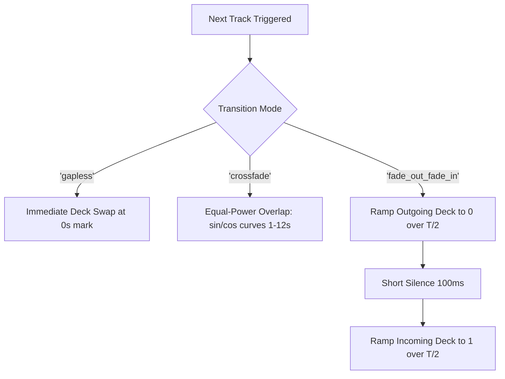

# HARMONIQ 2.0 — PHASE 5C ARCHITECTURE AUDIT & IMPLEMENTATION BLUEPRINT
## ADVANCED LISTENING EXPERIENCE & AUDIO PLAYBACK HARDENING

**Version:** 2.0.0  
**Phase:** 5C.0  
**Branch:** `feature/phase5c-5d-advanced-audio-intelligence`  
**Baseline Commit:** `0299d66` (`checkpoint-phase5b7-complete`)  
**Status:** Approved for Implementation  

---

## 1. EXECUTIVE SUMMARY & AUDIT OBJECTIVES

Phase 5B established a world-class, dual-deck audio processing engine featuring 10-band and 12-band parametric equalizers, unified sound profiles, per-track EQ memory, per-device profiles, and audio quality transparency.

Phase 5C expands the user-facing listening experience with professional-grade controls, transitions, synced lyrics, visualizers, and listening sessions.

The primary goals of Phase 5C are:
1. **Intelligent Playback Transitions (5C.1)**:
   - Replace linear crossfade ramps with mathematically optimal **equal-power crossfade curves** ($g_{\text{in}} = \sin(\frac{\pi}{2} t)$, $g_{\text{out}} = \cos(\frac{\pi}{2} t)$) to eliminate the -3 dB dip in perceived volume during song transitions.
   - Formalize three explicit transition modes: `'crossfade'` (equal-power blend, 1–12s), `'gapless'` (instantaneous zero-silence deck swap), and `'fade_out_fade_in'` (clean outgoing silence before incoming track begins).
   - Harden queue switching, seek operations, and rapid track skipping against race conditions and audio clipping.
2. **Advanced Listening Controls (5C.2)**:
   - Smooth variable playback speed (0.5x, 0.75x, 1.0x, 1.25x, 1.5x, 1.75x, 2.0x) with pitch preservation (`preservesPitch = true`).
   - Unified A-B Repeat loop control with keyboard shortcuts and clear visual loop range indicators.
   - Comprehensive Listening Bookmarks integration: timestamp tagging, custom notes, click-to-seek, and track-specific persistence.
   - Sleep & Session Timer enhancements: "Stop after current track", "Stop after queue", and gradual volume fade-out.
3. **Advanced Lyrics Experience (5C.3)**:
   - Interactive click-to-seek directly from synced lyric lines.
   - Persistent per-track offset memory stored in local storage (`harmoniq_lyrics_offset_<trackId>`).
   - Four distinct display modes: `standard` (scrolling list), `compact` (floating/docked 3-line card), `fullscreen` (ambient presentation), and `minimal` (focused karaoke line).
4. **Advanced Visual Listening Experience (5C.4)**:
   - Full support for 8 visualizer themes: `minimal-bars`, `neon-spectrum`, `circular-spectrum`, `waveform`, `particle-field`, `retro-equalizer`, `ambient-waves`, and `frequency-rings`.
   - Dynamic Now Playing ambient gradient and accent coloring derived from track album artwork.
   - Immersive Fullscreen listening mode with integrated playback controls, artwork, lyrics toggle, and visualizer theme picker.
5. **Listening Session Experience (5C.5)**:
   - Dedicated `SessionTrackingService` capturing session start/end timestamps, active listening duration, tracks played, completion vs. skip metrics, and replay capability.
   - Comprehensive privacy controls (toggle session tracking, clear session history).
6. **Phase 5C QA & Final Report (5C.6)**:
   - 100% test coverage for new transition math, bookmark operations, session tracking, and control logic.
   - Full regression validation of existing 574 tests across 48 test suites.

---

## 2. EXISTING CODEBASE INVENTORY & GAP ANALYSIS

| Component | Existing Implementation | Architectural Gap | Phase 5C Remediation |
| :--- | :--- | :--- | :--- |
| **Crossfade Engine** | `audioEngine.startCrossfadeTransition` uses `linearRamp` | Linear ramp causes a -3 dB power drop in the middle ($0.5^2 + 0.5^2 = 0.5$). | Introduce `AudioParameterAutomation.equalPowerFade` using sine/cosine curves; add `fade_out_fade_in` mode. |
| **Transition Modes** | Implicitly switches based on `crossfadeDuration === 0` | No explicit configuration for `fade_out_fade_in` or transition type choice in UI/state. | Expose `transitionType: 'crossfade' \| 'gapless' \| 'fade_out_fade_in'` in `PlayerContext`. |
| **Playback Speed** | `setPlaybackRate` exists in `audioEngine.ts` | Speed control lacks a convenient preset menu (0.5x–2.0x) in the main player bar and Now Playing. | Add quick speed selector popover in `BottomPlayer` and `NowPlayingView`. |
| **A-B Repeat** | Engine & `PlayerContext` implement A-B loop | Shortcuts (e.g. `[`, `]`, `\`) not bound globally; visual state can be enriched. | Enhance `BottomPlayer` / `ABRepeatControls` and bind global keyboard triggers. |
| **Bookmarks** | `BookmarkService` exists with storage key `harmoniq_music_bookmarks_v1` | No bookmark button or listing in `NowPlayingView` / `BottomPlayer`; cannot add notes while listening. | Integrate bookmark creation popover and track bookmarks list in `NowPlayingView`. |
| **Lyrics Sync & Offset** | `LyricsView.tsx` supports synced lyrics and manual offset adjustment | `offsetMs` resets on track change; only standard view is available. | Persist offset per track; add `compact`, `fullscreen`, and `minimal` layout modes. |
| **Visualizers** | 8 themes defined in `visualizerSettingsService.ts` and `FullScreenVisualizer.tsx` | Needs seamless toggle between modes and dynamic artwork color accent glow. | Connect `colorExtractionService` to Now Playing visualizer backdrop and UI accents. |
| **Session Tracking** | `historyService.ts` records individual track plays | No concept of a continuous "listening session" (session duration, total tracks, session replay). | Build `SessionTrackingService` with session history, analytics, replay, and privacy settings. |

---

## 3. COMPONENT ARCHITECTURE & IMPLEMENTATION STRATEGY

### 3.1 Transition Math & Equal-Power Curves

The perceived acoustic power $P$ of two overlapping audio signals $A$ and $B$ with gains $g_A$ and $g_B$ is proportional to the sum of their squared amplitudes:
$$P(t) \propto g_A(t)^2 + g_B(t)^2$$

With linear crossfading ($g_A(t) = 1 - t$, $g_B(t) = t$ for normalized time $t \in [0, 1]$):
$$P(0.5) = 0.5^2 + 0.5^2 = 0.25 + 0.25 = 0.50 \implies 10 \log_{10}(0.5) \approx -3.01\text{ dB}$$

To maintain constant acoustic power throughout the entire transition duration $T$:
$$g_{\text{incoming}}(t) = \sin\left(\frac{\pi}{2} \cdot \frac{t}{T}\right)$$
$$g_{\text{outgoing}}(t) = \cos\left(\frac{\pi}{2} \cdot \frac{t}{T}\right)$$
$$P(t) = \sin^2\left(\frac{\pi}{2} \cdot \frac{t}{T}\right) + \cos^2\left(\frac{\pi}{2} \cdot \frac{t}{T}\right) = 1.0 \equiv 0\text{ dB (Constant)}$$

This curve will be implemented in `AudioParameterAutomation.equalPowerFade` via `setValueCurveAtTime` using 64 sampling points, with graceful fallback to exponential/linear ramps when running under synthetic test harnesses.

### 3.2 Transition Modes



### 3.3 Listening Bookmarks

Bookmarks allow listeners, students, audio engineers, and music fans to tag moments in a song with notes:
```typescript
export interface MusicBookmark {
  id: string;
  trackId: string;
  title: string;
  note?: string;
  timestamp: number;
  dateCreated: number;
}
```
`BookmarkService` persists bookmarks to `harmoniq_music_bookmarks_v1`. We will expose bookmarks directly in `PlayerContext` and provide quick-tagging in `NowPlayingView` and `BottomPlayer`.

### 3.4 Lyrics Display Modes

1. **Standard Mode**: Full vertical scrolling list with time tags and active line highlighted in vivid violet glow.
2. **Compact Mode**: 3-line card (previous, current, next) ideal for side-panel and overlay view.
3. **Fullscreen Mode**: Large typographic focus with blurred dynamic artwork backdrop.
4. **Minimal Mode**: Single active lyric line ticker with crossfade transitions.

### 3.5 Session Tracking Model

```typescript
export interface ListeningSession {
  id: string;
  startedAt: number;
  endedAt: number | null;
  durationSeconds: number;
  tracks: SessionTrackEntry[];
  totalTracksCount: number;
  completedCount: number;
  skippedCount: number;
}

export interface SessionTrackEntry {
  track: TrackMetadata;
  startedAt: number;
  playedDurationSeconds: number;
  status: 'completed' | 'skipped' | 'partial';
}
```

---

## 4. RISKS & MITIGATIONS

1. **Web Audio Automation Timing Conflicts**:
   - *Risk*: Rapid track skipping while an equal-power crossfade is executing could leave faders in an indeterminate state.
   - *Mitigation*: `cancelCrossfade()` immediately clears timeouts, invokes `cancelScheduledValues()`, resets incoming deck to gain 0, and restores active deck to gain 1.
2. **Local Storage Growth**:
   - *Risk*: Unbounded session history could bloat `localStorage`.
   - *Mitigation*: Cap session history at 50 sessions and individual history at 5,000 entries. Provide one-click data purge.
3. **DOM Performance in Lyrics View**:
   - *Risk*: Frequent scroll repositioning on timeupdate could cause frame drops.
   - *Mitigation*: Debounce auto-scroll, suppress auto-scroll while user is manually wheel-scrolling, and use CSS `transform` / `scroll-behavior: smooth`.

---

## 5. VERIFICATION CRITERIA

- Equal-power math validated: $\sin^2(\theta) + \cos^2(\theta) == 1.0$ within floating point tolerance.
- Transition cancellation tested: skipping during transition immediately stops crossfade without clicks.
- Playback rate presets verified with `preservesPitch: true`.
- Lyrics click-to-seek and per-track offset memory verified.
- Session tracker tested for session lifecycle, metrics aggregation, and replay into queue.
- 100% pass on all existing 574 tests plus new Phase 5C test suite.
