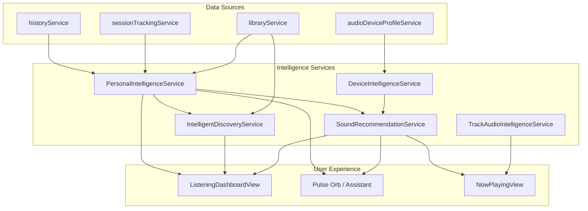

# HARMONIQ 2.0 — PHASE 5D ARCHITECTURE AUDIT & IMPLEMENTATION BLUEPRINT
## PERSONALIZED AUDIO INTELLIGENCE & ADAPTIVE LISTENING ARCHITECTURE

**Version:** 2.0.0  
**Phase:** 5D.0  
**Branch:** `feature/phase5c-5d-advanced-audio-intelligence`  
**Baseline Commit:** `a53e2f4` (`checkpoint-phase5c-complete`)  
**Status:** Approved for Implementation  

---

## 1. EXECUTIVE SUMMARY & OBJECTIVES

Harmoniq 2.0 has established an advanced playback engine, dual-deck equal-power transitions, unified sound profiles, per-track EQ memory, and listening session recovery.

Phase 5D builds an intelligent, explainable, and privacy-respecting **Personalized Audio Intelligence System**. It operates entirely locally on device, transforming raw listening telemetry into actionable insights, acoustic optimization recommendations, device-specific tuning, and explainable music discovery.

The primary goals of Phase 5D are:
1. **Personal Listening Intelligence (5D.1)**:
   - Aggregate history, sessions, and library data into a cohesive listening profile.
   - Compute top artists, albums, and genres weighted by active listening duration and completion rates.
   - Detect listening rhythms across 4 daily time partitions (Morning, Afternoon, Evening, Late Night).
   - Analyze genre-specific skip vs. completion ratios.
2. **Adaptive Sound Recommendations (5D.2)**:
   - Generate intelligent, explainable EQ and sound profile recommendations based on active output device, track genre, and user preferences.
   - Provide non-destructive Audition (Preview), Apply, and Restore capabilities.
3. **Intelligent Per-Track Audio Optimization (5D.3)**:
   - Perform lightweight dynamic range and headroom analysis.
   - Identify clipping risks when aggressive EQ gain or ReplayGain is engaged.
   - Recommend smart preamp headroom to prevent digital clipping while preserving transient punch.
4. **Headphone & Audio Device Intelligence (5D.4)**:
   - Classify audio devices (Wired Headphones, USB DACs, Bluetooth A2DP, Built-in Speakers, Desktop Monitors).
   - Suggest target compensation profiles (Harman Target, open-back bass boost, diffuse field).
   - Handle seamless device switching with adaptive profile prompts.
5. **Intelligent Music Discovery (5D.5)**:
   - Four distinct explainable discovery categories: "Similar to Your Favorites", "Recently Discovered", "Forgotten Favorites", and "Fresh Artists".
   - Transparent rationale attached to every recommendation card.
6. **Personal Listening Dashboard (5D.6)**:
   - Interactive React view `ListeningDashboardView.tsx` with 5 cohesive sections: Overview, Listening Trends, Discovery Insights, Playback Insights, and Audio Configuration Insights.
   - Time filters (7 Days, 30 Days, All Time) and privacy controls (JSON export, data clear).
7. **Pulse Orb & AI Assistant Integration (5D.7)**:
   - Extend `assistantService.ts` and `assistantKnowledge.ts` with intent recognition for listening stats, sound advice, and smart playlist generation from intelligence data.
8. **Phase 5D QA & Final Report (5D.8)**:
   - Comprehensive test suite covering calculation math, recommendation logic, device heuristics, and assistant intents.

---

## 2. CODEBASE INVENTORY & GAP ANALYSIS

| Component | Existing Foundation | Architectural Gap | Phase 5D Solution |
| :--- | :--- | :--- | :--- |
| **Listening Telemetry** | `historyService.ts` and `sessionTrackingService.ts` | Telemetry is recorded in disjoint arrays without multidimensional aggregation or time-of-day analytics. | Create `PersonalIntelligenceService` to compute weighted affinities, time patterns, and skip rates. |
| **Sound Profiles** | `soundProfileService.ts` and `trackAudioProfileService.ts` | Profiles must be selected manually; no automated suggestions based on detected context. | Build `SoundRecommendationService` with explainable advice and non-destructive auditioning. |
| **Track Audio Analysis** | `inspectorService.ts` provides metadata inspection | No dynamic range estimation, peak headroom analysis, or clipping prevention suggestions. | Implement `TrackAudioIntelligenceService` with smart headroom and clipping protection advice. |
| **Device Intelligence** | `audioDeviceProfileService.ts` stores volume and profile ID | Does not categorize device types or suggest headphone compensation curves. | Create `DeviceIntelligenceService` with device classification and target curve matching. |
| **Music Discovery** | `discoveryService.ts` searches library by basic criteria | Lacks categorized explainable suggestions ("Forgotten Favorites", "Similar to Favorites"). | Build `IntelligentDiscoveryService` with transparent rationale strings. |
| **Analytics UI** | Basic stats in `statsService.ts` | No dedicated visual dashboard view for listening trends and audio configuration insights. | Create `ListeningDashboardView.tsx` with 5 detailed sections and date filtering. |
| **AI Assistant** | `assistantService.ts` answers playback commands | Assistant lacks awareness of personal listening stats and sound recommendations. | Extend assistant knowledge base and intent handlers with intelligence capabilities. |

---

## 3. ARCHITECTURAL BLUEPRINT

---

## 4. MATHEMATICAL MODELS & FORMULAS

### 4.1 Artist Affinity Weighting
$$\text{Affinity}(A) = \sum_{t \in \text{Plays}(A)} \left( \frac{\text{Duration}(t)}{60} \times w_{\text{status}}(t) \times w_{\text{recency}}(t) \right)$$
Where:
- $w_{\text{status}} = 1.0$ if completed, $0.5$ if partial, $0.1$ if skipped.
- $w_{\text{recency}} = \exp\left(-\frac{\Delta \text{days}}{30}\right)$ (half-life of ~21 days for freshness).

### 4.2 Clipping Risk & Smart Headroom
Given track peak amplitude $A_{\text{peak}}$, ReplayGain adjustment $G_{\text{rg}}$ (dB), and maximum active EQ band gain $G_{\text{eq\_max}}$ (dB):
$$\text{Peak}_{\text{est}} = A_{\text{peak}} + \max(0, G_{\text{rg}}) + \max(0, G_{\text{eq\_max}})$$
$$\text{If } \text{Peak}_{\text{est}} > 0\text{ dBFS} \implies \text{Clipping Risk} = \text{true}$$
$$\text{Recommended Headroom} = -\max(0, \text{Peak}_{\text{est}} + 0.5)\text{ dB}$$

---

## 5. VERIFICATION STRATEGY

1. **Deterministic Unit Tests**:
   - Math tests verifying affinity calculations, time-of-day bins, and recency decay.
   - Clipping risk detection tests with positive and negative dB thresholds.
   - Device classification heuristics (identifying AirPods, HD650, Realtek speakers, USB DACs).
   - Discovery categorization ("Forgotten Favorites" properly isolates tracks played > 30 days ago).
2. **Regression Assurance**:
   - Verify all 587 tests remain green.
   - Verify Electron and Vite production builds pass with zero type errors.
