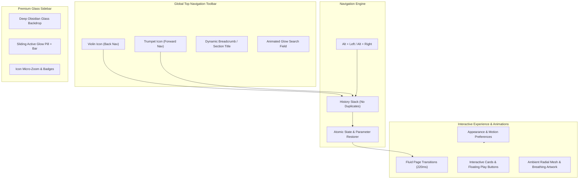

# Harmoniq – Premium UI/UX Transformation Report

## Executive Summary

Harmoniq has undergone a comprehensive UI/UX transformation to establish its own musical identity, fluid interactions, tactile micro-animations, and intuitive desktop navigation.

All 21 test suites (158 unit tests) passed with 100% green coverage, Vite and TypeScript builds succeeded with zero errors, and updated Windows binaries and installers were packaged.

---

## 1. Key Transformation Highlights



---

## 2. Part-by-Part Architectural Implementation

### Part 1 & 7: Signature Musical Navigation & Global Top Toolbar
- **Custom Violin (Back Navigation)**:
  - Minimalist silhouette of a violin featuring a left-oriented diagonal bow with a distinct arrowless leftward affordance.
  - Rendered in [MusicalNavigation.tsx](file:///C:/Users/a2301/Desktop/harmoniq/src/components/layout/MusicalNavigation.tsx) using vector SVG geometry (`viewBox="0 0 24 24"`, stroke width 1.6).
  - Hover states feature an ambient violet glow pill and leftward nudge (`group-hover:-translate-x-0.5`).
  - Tactile press animation (`active:scale-90`).
  - Accessible tooltip `"Go Back (Alt + Left)"` and `aria-label="Go Back"`.
- **Custom Trumpet (Forward Navigation)**:
  - Minimalist trumpet oriented to the right with 3 piston valve buttons, leadpipe, and sound projection waves.
  - Styled to form a matching visual pair with the violin.
  - Hover states feature rightward translation and violet glow.
  - Accessible tooltip `"Go Forward (Alt + Right)"` and `aria-label="Go Forward"`.
- **Navigation History Stack in [NavigationContext.tsx](file:///C:/Users/a2301/Desktop/harmoniq/src/context/NavigationContext.tsx)**:
  - Tracks all visits across: `Home`, `Discover`, `Songs`, `Albums`, `Artists`, `Folders`, `Playlists`, `Favorites`, `Recently Played`, `Album Details`, `Artist Details`, `Now Playing`, `EQ Studio`, `Visualizer`, `Inspector`, `Lyrics`, `Audio Output`, `Settings`, `Stats`, `Online Music`, `Radio`, and `Podcasts`.
  - Preserves selected entity parameters (`selectedAlbum`, `selectedArtist`, `selectedPlaylist`).
  - Deduplicates consecutive navigation actions.
  - Drops forward history upon branching to a new route.
  - Disables buttons when stack boundaries are reached.
  - Global keyboard shortcuts: `Alt + ArrowLeft` and `Alt + ArrowRight` (auto-suppressed when typing in text fields).
- **Top Toolbar in [TitleBar.tsx](file:///C:/Users/a2301/Desktop/harmoniq/src/components/layout/TitleBar.tsx)**:
  - Integrated with Brand Logo, Musical Navigation, and dynamic breadcrumbs.
  - Search field features violet focus ring (`focus:border-[#A78BFA]/70 focus:ring-2 focus:ring-[#A78BFA]/15`) and animated clear button.

---

### Part 2: Premium Glass Sidebar
- Upgraded in [Sidebar.tsx](file:///C:/Users/a2301/Desktop/harmoniq/src/components/layout/Sidebar.tsx):
  - Translucent glass appearance: `bg-[#0D0D12]/90 backdrop-blur-2xl border-r border-[#272733]/80`.
  - Background radial ambient violet flare (`blur-3xl pointer-events-none`).
  - Active Section Indicator: Glowing gradient pill (`from-violet-600/20 via-violet-600/10 to-transparent`) accented with a vertical glowing violet bar (`bg-[#A78BFA] shadow-[0_0_8px_rgba(167,139,250,0.8)]`).
  - Animated icon micro-zooms on hover (`group-hover:scale-110 duration-200`).
  - Group separation and custom playlist quick-list with `+` create button.

---

### Part 3: Interactive Content Cards
- Enhanced in [HomeView.tsx](file:///C:/Users/a2301/Desktop/harmoniq/src/components/views/HomeView.tsx), [LibraryView.tsx](file:///C:/Users/a2301/Desktop/harmoniq/src/components/views/LibraryView.tsx), and [index.css](file:///C:/Users/a2301/Desktop/harmoniq/src/index.css):
  - Added `.card-interactive`: subtle elevation (`translateY(-4px)`), soft violet shadow (`shadow-[0_14px_34px_-4px_rgba(0,0,0,0.5),0_0_20px_rgba(167,139,250,0.16)]`), and border transition.
  - Smooth artwork zoom: `group-hover:scale-105 duration-500 ease-out`.
  - Floating Quick-Play Button (`.floating-play-btn`): smoothly fades and slides up on card hover (`opacity-0 translate-y-2 group-hover:opacity-100 group-hover:translate-y-0 duration-250`).
  - Subtle click feedback (`active:scale-[0.98]`).

---

### Part 4: Ambient Now Playing Experience
- Upgraded in [NowPlayingView.tsx](file:///C:/Users/a2301/Desktop/harmoniq/src/components/views/NowPlayingView.tsx):
  - Multi-layered blurred ambient glow behind the artwork reacting to colors extracted from the track cover.
  - Floating artwork breathing animation (`animate-artwork-breathing`) smoothly scaling and pulsing with audio dynamics.
  - 33⅓ RPM rotating vinyl disk mode (`animate-vinyl`) with concentric groove highlights and center spindle.
  - Respects appearance settings and reduced-motion preferences.

---

### Part 6: Fluid Page Transitions
- Implemented in [index.css](file:///C:/Users/a2301/Desktop/harmoniq/src/index.css) and [App.tsx](file:///C:/Users/a2301/Desktop/harmoniq/src/App.tsx):
  - `.animate-page-enter`: 220ms ease-out fade and subtle vertical slide (`opacity: 0 -> 1`, `translateY(6px -> 0)`).
  - Clean view transitions without content flashing or component unmounting.

---

### Part 8: Appearance & Animation Settings
- Built in [appearanceService.ts](file:///C:/Users/a2301/Desktop/harmoniq/src/services/appearanceService.ts) and [SettingsView.tsx](file:///C:/Users/a2301/Desktop/harmoniq/src/components/views/SettingsView.tsx):
  - Dedicated **"Appearance & Animations"** settings card and tab.
  - Settings:
    1. **Master UI Animations Toggle**: enable/disable all motion.
    2. **Animation Intensity**: `Subtle`, `Normal`, or `Enhanced`.
    3. **Reduced Motion**: accessibility toggle with automatic detection of `(prefers-reduced-motion: reduce)`.
    4. **Interactive Hover Effects**: card elevations and quick-play button reveals.
    5. **Album Artwork Animations**: breathing float and rotating vinyl.
    6. **Dynamic Ambient Lighting**: radial backdrop glow.
  - Persistent in `localStorage` and immediately synchronizes attributes on `document.documentElement` (`data-animations`, `data-animation-intensity`, `data-reduced-motion`, `data-hover-effects`, `data-ambient-lighting`, `data-album-animations`).

---

## 3. Verification & Build Summary

### Vitest Unit Tests
```
 Test Files  21 passed (21)
      Tests  158 passed (158)
   Duration  4.59s
```

All 21 test suites passed:
1. `premium_ui_ux_transformation.test.ts` (7 tests)
2. `batch12_online_music_integration.test.ts` (10 tests)
3. `core_playback_enhancements.test.ts` (12 tests)
4. `windows_integration.test.ts` (15 tests)
5. `visualizer_and_eq.test.ts` (12 tests)
6. `audio_quality_and_controls.test.ts` (17 tests)
7. `batch7_library_management.test.ts` (9 tests)
8. `batch8_library_maintenance.test.ts` (5 tests)
9. `batch9_10_discovery_and_info.test.ts` (3 tests)
10. `batch11_listening_statistics.test.ts` (4 tests)
11. `batch13_online_music_management.test.ts` (5 tests)
12. `batch14_advanced_visual_experience.test.ts` (4 tests)
13. `functionality_fixes.test.ts` (15 tests)
14. `regression.test.ts` (11 tests)
15. `inspector.test.ts` (7 tests)
16. `library.test.ts` (5 tests)
17. `lyrics.test.ts` (3 tests)
18. `karaoke_lrc_advanced.test.ts` (5 tests)
19. `sleep_timer.test.ts` (3 tests)
20. `metadata_tagger.test.ts` (2 tests)
21. `color_extraction.test.ts` (4 tests)

### Build & Release Artifacts
- **Vite & TypeScript Frontend**: Built in 12.07s with zero errors (`dist/`).
- **Electron Main & Preload Scripts**: Compiled with zero errors (`dist-electron/`).
- **Windows Installers & Executables** in [release/](file:///C:/Users/a2301/Desktop/harmoniq/release):
  - `Harmoniq Setup 1.0.0.exe` (85,426,098 bytes)
  - `Harmoniq 1.0.0.exe` (85,198,397 bytes)
