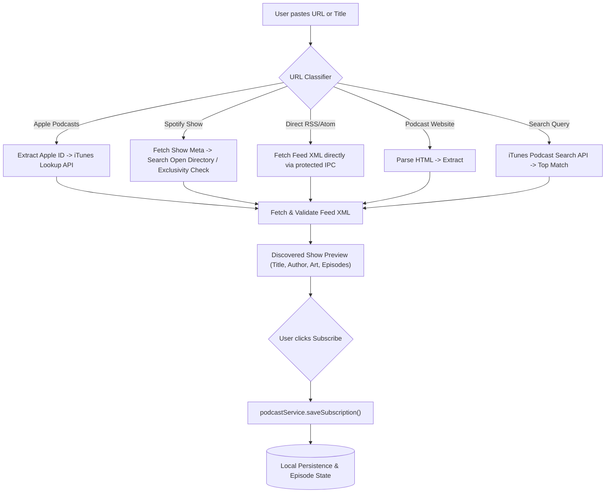

# HARMONIQ – SMART PODCAST URL IMPORTER
## Engineering & Architecture Implementation Report

---

### Executive Summary

Harmoniq's Podcast system has been upgraded with a **Smart Podcast URL Importer**. Users no longer need to hunt down obscure direct RSS feed XML links; they can now paste ordinary podcast website URLs, Apple Podcasts URLs, Spotify show links, direct RSS/Atom feeds, or podcast titles into Harmoniq.

The system features:
1. **A dedicated Smart Podcast Importer Modal (`AddPodcastModal.tsx`)**: Featuring Harmoniq's signature dark obsidian-glass aesthetics with violet/lavender accents, an animated multi-step discovery indicator, rich show preview, episode count and latest episode previews, and duplicate subscription detection.
2. **A dedicated Podcast URL Resolver Engine (`podcastResolver.ts` & Electron IPC handler `podcast:resolveUrl`)**: Implements multi-tier detection, Apple Podcasts API lookup, Spotify open-feed discovery with walled-garden exclusivity warnings, HTML alternate RSS link extraction, SSRF security validation, and XML episode parsing.
3. **Comprehensive Test Coverage**: 29 Vitest test suites (272 tests) with 100% pass rate.

---

### Architectural Flow

---

### 1. Files Created & Modified

#### Files Created
1. `src/types/podcastResolver.ts`: Type definitions for `PodcastUrlType`, `ResolvedPodcastPreview`, `ResolverProgressState`, and `ResolverStepId`.
2. `src/services/podcastResolver.ts`: Client-side resolver service coordinating URL classification, progress reporting, and backend IPC communication.
3. `src/components/online/AddPodcastModal.tsx`: Premium modal window with animated step progress, platform badges, show preview card, duplicate check, and error handling.
4. `src/test/smart_podcast_resolver.test.ts`: Automated test suite covering URL classification, direct RSS parsing, Apple Podcasts resolution, Spotify exclusivity handling, duplicate prevention, and error states.

#### Files Modified
1. `electron/main.ts`: Added IPC handler `podcast:resolveUrl` with SSRF protection (`isSafePublicUrl`), iTunes Lookup & Search integration, Spotify metadata extraction, HTML alternate link scraping, and bounded timeouts.
2. `electron/preload.ts`: Exposed `resolvePodcastUrl` via Electron `contextBridge`.
3. `src/types/electron.ts`: Added `resolvePodcastUrl` to the `HarmoniqApi` interface.
4. `src/components/online/PodcastView.tsx`: Added prominent "Add Podcast" action button in the header, updated empty state action, and mounted `<AddPodcastModal />`.

---

### 2. Multi-Platform URL Detection & Resolution Engine

| Input Format | Resolution Strategy | Expected Outcome |
| :--- | :--- | :--- |
| **Direct RSS / Atom Feed** `https://feeds.npr.org/510289/podcast.xml` `https://.../feed` | Direct fetch with SSRF check and XML validation | Direct resolution of episodes and show metadata. |
| **Apple Podcasts** `https://podcasts.apple.com/.../id510289` | Extracts numeric show ID, calls `https://itunes.apple.com/lookup?id=${id}&entity=podcast`, extracts canonical `feedUrl` | Fetches open RSS feed; resolves full metadata and show artwork. |
| **Spotify Show Link** `https://open.spotify.com/show/4rOoJ...` | Scrapes public show title from Spotify page, queries open podcast directory, matches title | Resolves public RSS feed if open; if walled-garden exclusive, displays clear explanation. |
| **Podcast Website** `https://atp.fm` `https://relay.fm/cortex` | Scrapes `<link rel="alternate" type="application/rss+xml" href="...">` from HTML `<head>` | Discovers hidden RSS feed; resolves relative URLs against origin base. |
| **Show Title Query** `"Planet Money"`, `"Huberman Lab"` | Queries iTunes Podcast Search API for top matching show | Discovers canonical RSS feed directly from podcast directory. |

---

### 3. SSRF Defense & Security Architecture

To prevent Server-Side Request Forgery (SSRF) and protect internal networks:
1. **Host Verification (`isSafePublicUrl`)**:
   - Rejects `localhost`, `*.localhost`, `127.0.0.1`, `0.0.0.0`, `::1`.
   - Rejects private IP subnets: `10.0.0.0/8`, `192.168.0.0/16`, `172.16.0.0/12`, `169.254.0.0/16`.
   - Rejects non-HTTP protocols (`file://`, `ftp://`, `gopher://`, `javascript:`).
2. **Resource Boundaries**:
   - Network requests are enforced with an explicit 14-second timeout via `AbortController`.
   - Webpage HTML fetches are capped to 2.5 MB.
   - RSS XML fetches are capped to 15 MB.
3. **No Leaked Credentials**:
   - All directory lookups and network fetching are executed strictly within the Electron main process.

---

### 4. Subscription & Duplicate Prevention

When a user confirms subscription:
- `podcastService.saveSubscription(feed)` checks both `feed.feedUrl` and `feed.title` against existing subscriptions.
- If already subscribed, the modal surfaces an `"Already Subscribed"` badge and prevents duplicate entries.
- Episode playback positions and listened flags are preserved across app sessions.
